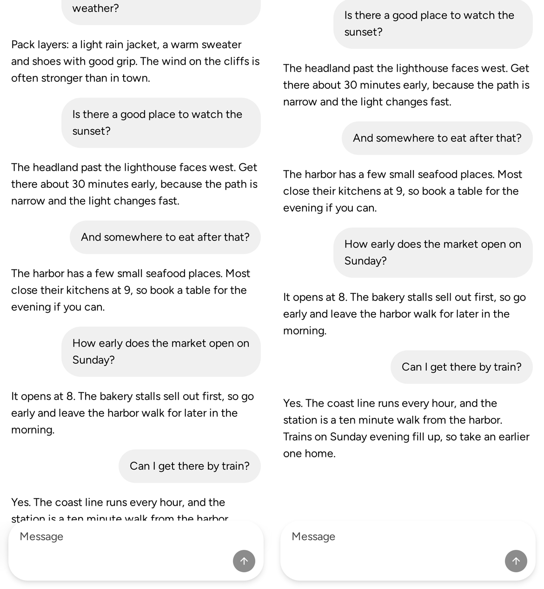
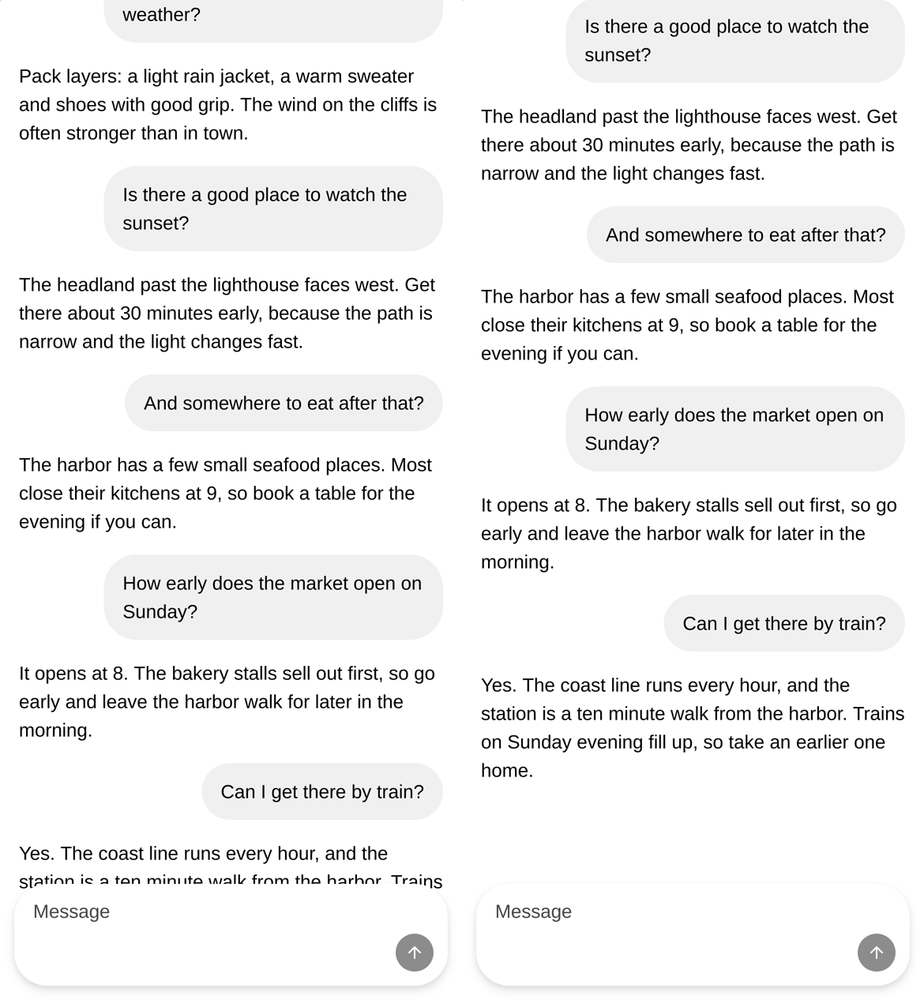
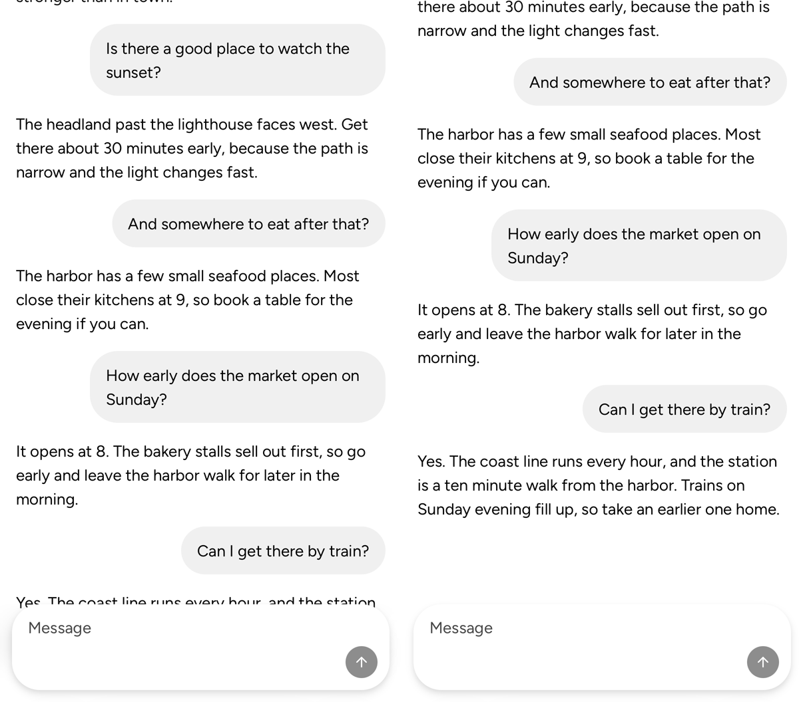

# ChatLayout with a scrollRef: the newest message and the fixed dock

Page: the Sandbox's Chat Layout page, `?case=long` (the document scrolls), at
the document's end. Left: main 4c1d64f5fc with #10672's page. Right: this fix at
ef91096065. Phone, 390 × 844 at 3×, in Chromium, in WebKit, and in Safari on the
iOS 26.2 Simulator (the page area only, keyboard down).

