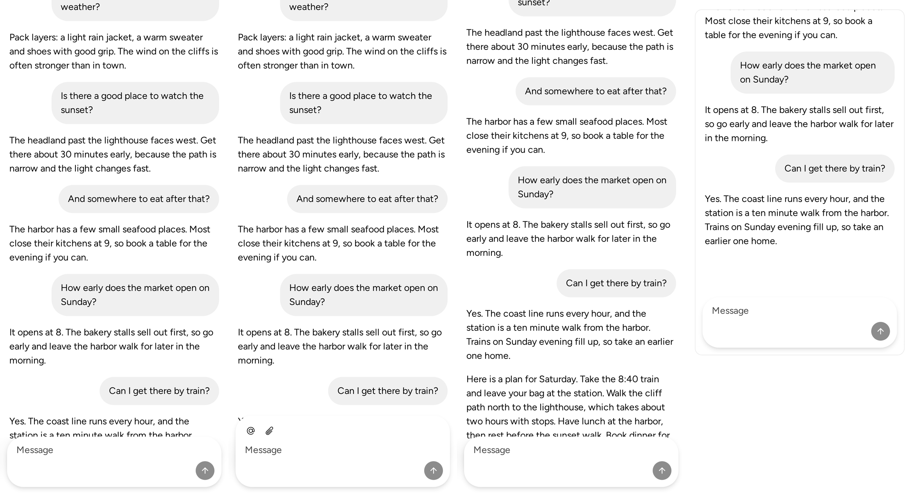
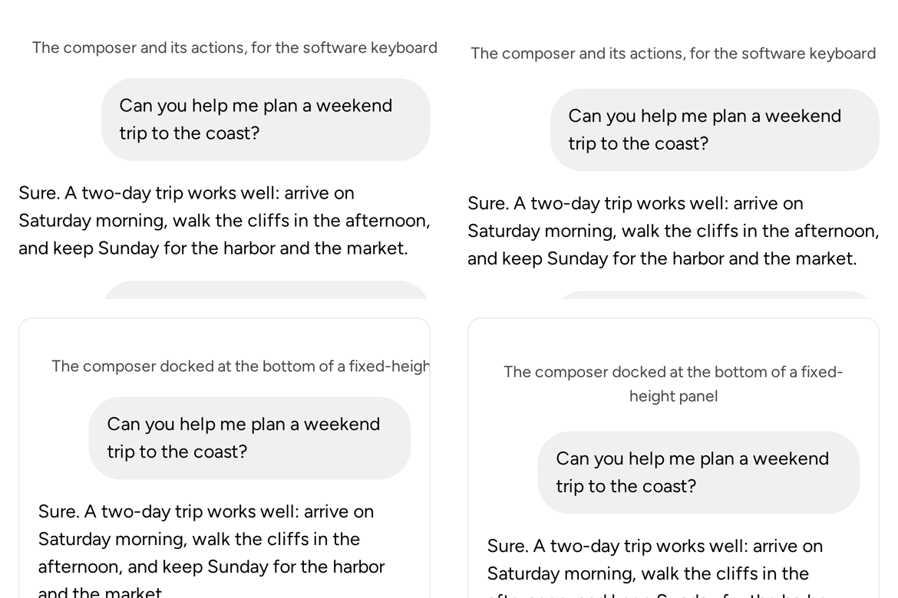
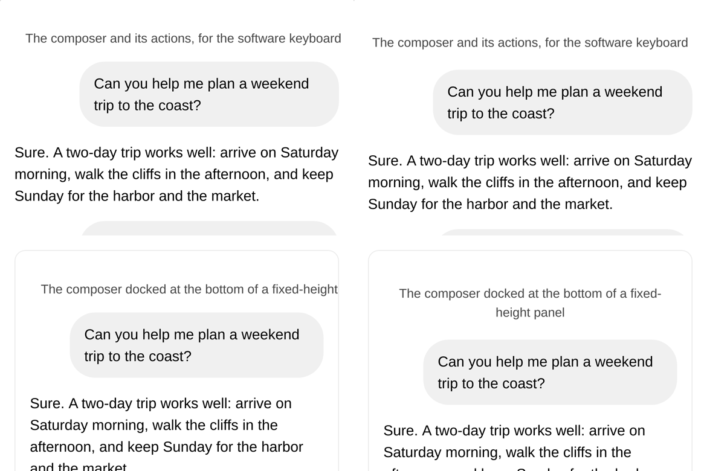

# The Sandbox's Chat Layout page, one capture per case

Build: `sandbox-chat-layout-page` at b468198b99. Phone: 390 × 844 at 3×, as a touch
device, in Chromium and WebKit. Left to right: `?case=long`, `?case=composer`,
`?case=streaming` (after its reply streamed in) and `?case=docked`.

The case names at the top of the composer and docked cases, at 390 px: left at
a3676be0bd (a divider label that does not shrink), right at b468198b99 (a system
message that wraps).

