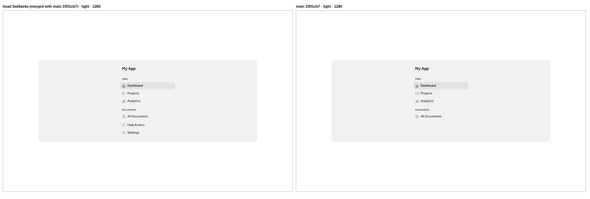
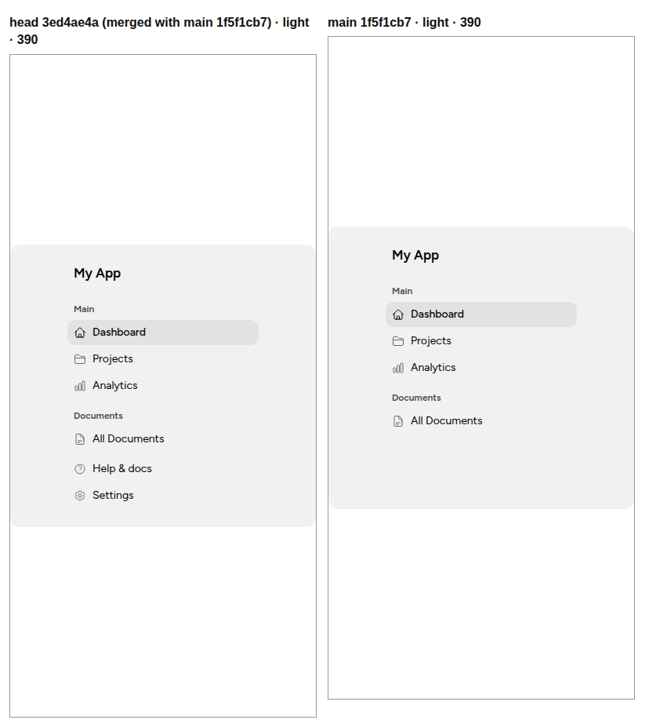
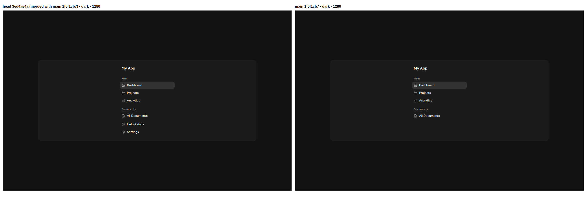
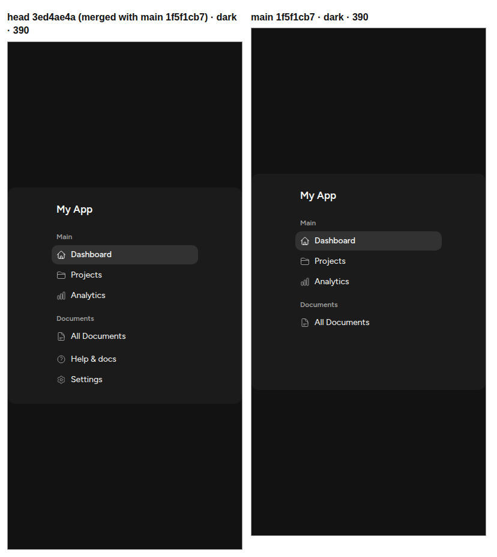

# SideNav showcase footer (#11267): head vs main

Frames of the SideNav showcase block from two builds: meta/astryx #11267 at 3ed4ae4a merged with main 1f5f1cb7 (head), and main 1f5f1cb7 (main). The head build's stamp in measurements.json, 4d0322c8, is that local merge commit, which is not published. Its tree is 1f8a59c3, the tree `git merge-tree --write-tree 3ed4ae4a 1f5f1cb7` gives. Each build is the repository's Sandbox app (`pnpm -F @astryxdesign/sandbox build`), served locally.

Chromium 149 opened `/templates/SideNavShowcase/?embed=1&theme=neutral&mode=light` (and `mode=dark`) at 1280 × 800 and 390 × 844. The neutral theme's own font files served the fonts. Every number below was measured on those local builds; [measurements.json](measurements.json) has them all.

Main has no footer, because the pull request adds it. So main's showcase shows as it is, and the focus and icon checks cover the head only.

## At rest

Head is on the left and main is on the right.









## Names

- The footer adds a "Support" group with two links: "Help & docs" (`/help`) and "Settings" (`/settings`).
- Each link's accessible name is its visible label. Neither link has an `aria-label`.
- Each link's icon is `aria-hidden="true"`. The footer has no icon-only control.
- On main, the tree ends with the "Documents" group.

The nav's accessibility tree on the head build, the same in every frame:

```
- navigation "Side navigation":
  - link "My App":
    - /url: /
  - group "Main":
    - text: Main
    - link "Dashboard":
      - /url: /dashboard
    - link "Projects":
      - /url: /projects
    - link "Analytics":
      - /url: /analytics
  - group "Documents":
    - text: Documents
    - link "All Documents":
      - /url: /documents
  - group "Support":
    - text: Support
    - link "Help & docs":
      - /url: /help
    - link "Settings":
      - /url: /settings
```

## Focus rings

- "Help & docs" is the sixth Tab stop from the top of the page, after My App, Dashboard, Projects, Analytics and All Documents. "Settings" is the next stop.
- Each control shows a `solid 2px` ring at offset `3px`, while `:focus-visible` matches. The ring is rgb(27, 27, 27) in light and rgb(241, 241, 241) in dark.
- Two ancestors clip the footer: the nav (`overflow: hidden`) and the showcase's card (`overflow: clip`, 12 px corners). Both hold the whole ring at every point, and so does the viewport.

| Scheme | Width | Control | Ring at full width | Mean width | Painted in the 4× crop | Lowest contrast inside / outside | Frames |
|---|---|---|---|---|---|---|---|
| light | 1280 | Help & docs | 100% | 2 px | 98.7% (straight runs 100%, corners 91.8%) | 15.25:1 / 15.25:1 | [page](head-light-1280-focus-help.png) · [4× crop](head-light-1280-ring-help-x4.png) |
| light | 1280 | Settings | 100% | 2 px | 98.7% (straight runs 100%, corners 91.8%) | 15.25:1 / 15.25:1 | [page](head-light-1280-focus-settings.png) · [4× crop](head-light-1280-ring-settings-x4.png) |
| light | 390 | Help & docs | 100% | 2 px | 98.7% (straight runs 100%, corners 91.7%) | 15.25:1 / 15.25:1 | [page](head-light-390-focus-help.png) · [4× crop](head-light-390-ring-help-x4.png) |
| light | 390 | Settings | 100% | 2 px | 98.7% (straight runs 100%, corners 91.7%) | 15.25:1 / 15.25:1 | [page](head-light-390-focus-settings.png) · [4× crop](head-light-390-ring-settings-x4.png) |
| dark | 1280 | Help & docs | 100% | 2 px | 98.7% (straight runs 100%, corners 91.6%) | 15.25:1 / 15.25:1 | [page](head-dark-1280-focus-help.png) · [4× crop](head-dark-1280-ring-help-x4.png) |
| dark | 1280 | Settings | 100% | 2 px | 98.7% (straight runs 100%, corners 91.6%) | 15.25:1 / 15.25:1 | [page](head-dark-1280-focus-settings.png) · [4× crop](head-dark-1280-ring-settings-x4.png) |
| dark | 390 | Help & docs | 100% | 2 px | 98.7% (straight runs 100%, corners 91.5%) | 15.25:1 / 15.25:1 | [page](head-dark-390-focus-help.png) · [4× crop](head-dark-390-ring-help-x4.png) |
| dark | 390 | Settings | 100% | 2 px | 98.7% (straight runs 100%, corners 91.5%) | 15.25:1 / 15.25:1 | [page](head-dark-390-focus-settings.png) · [4× crop](head-dark-390-ring-settings-x4.png) |

- The ring's straight runs carry its color at every sampled position. The rounded corners carry it at 91.5–91.8% of positions, because their curved edges are anti-aliased.
- The lowest contrast is 15.25:1 inside and 15.25:1 outside, against the nav behind the ring.

How the ring was measured:

- The measurement walks the ring's center line every 0.25 px. At each point, it reads the ring across its width at 8 positions.
- A position is clipped when it lies outside a clipping ancestor's rounded box or outside the viewport.
- "Painted" counts the positions whose pixel in the 4× crop matches the ring's color. [ring-paint-split.json](ring-paint-split.json) splits that share between straight runs and corners.
- Contrast compares the ring's color with the pixels next to it. Inside is the middle of the 3 px gap between the control and the ring. Outside is 1.5 px beyond the ring's outer edge.

## Icon contrast

| Scheme | Icon color | Nav background | Contrast (computed and sampled) |
|---|---|---|---|
| light | rgb(106, 106, 106) | rgb(241, 241, 241) | 4.79:1 |
| dark | rgb(158, 158, 158) | rgb(27, 27, 27) | 6.43:1 |

- Both footer icons measure the same in each scheme, at both widths.
- Both clear 3:1, the level WCAG 2.1 success criterion 1.4.11 asks of a graphic that carries meaning.
- These icons sit beside visible labels and are hidden from assistive technology. So the labels carry the meaning, and the contrast is reported either way.
