# StatusDot playground icon (#12259): the dot per variant, head vs main

Crops of the docsite's StatusDot page (`/components/StatusDot?tab=properties`) from two builds: meta/astryx #12259 at fcaf63e1 merged with main 2773b025 (head), and main 2773b025 itself (main). Each build is the repository's docsite (`pnpm -F @astryxdesign/docsite generate`, then `next build` and `next start`), served locally. Chromium 149 opened the page at 1280 × 800 in light and dark, and each crop is the dot at 8 device pixels per CSS pixel. Every number below was measured on those local builds; [measurements.json](measurements.json) has them all.

On the head build, the icon row's "svg" switch is on. Main has no icon slot switch (the pull request adds it), so main's dot shows as it is, with no mark.

The mark is the playground's 6 px SVG checkmark. It is `aria-hidden` and sits inside the 8 px dot, 1 px from each edge; the dot's own `aria-label` carries the status. StatusDot's doc says the icon "gives the status a non-color mark". So the table reports the mark's contrast either way. It uses the 3:1 that WCAG 2.1 success criterion 1.4.11 asks of a graphic that carries meaning. "Panel" is the playground's preview panel behind the dot: rgb(241, 241, 241) in light and rgb(27, 27, 27) in dark.

## Contrast

| Variant | Scheme | Dot fill | Mark ink | Mark vs fill (head) | Dot vs panel (head) | Dot vs panel (main) | Head | Main |
|---|---|---|---|---|---|---|---|---|
| success | light | rgb(47, 125, 51) | rgb(255, 255, 255) | 5.12:1 | 4.53:1 | 4.53:1 | 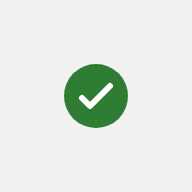 | 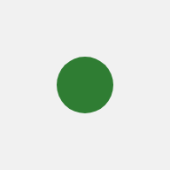 |
| warning | light | rgb(131, 103, 0) | rgb(255, 255, 255) | 5.38:1 | 4.76:1 | 4.76:1 | 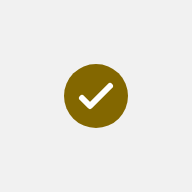 | 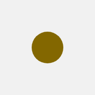 |
| error | light | rgb(192, 38, 44) | rgb(255, 255, 255) | 5.91:1 | 5.23:1 | 5.23:1 | 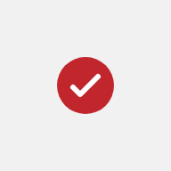 | 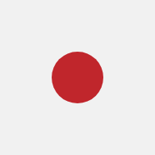 |
| accent | light | rgb(27, 27, 27) | rgb(255, 255, 255) | 17.22:1 | 15.25:1 | 15.25:1 | 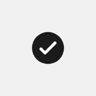 | 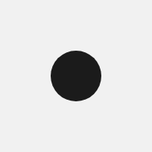 |
| neutral | light | rgb(106, 106, 106) | rgb(255, 255, 255) | 5.41:1 | 4.79:1 | 4.79:1 | 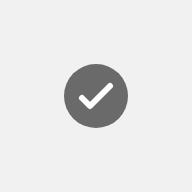 | 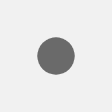 |
| success | dark | rgb(144, 202, 144) | rgb(38, 38, 38) | 7.95:1 | 9.05:1 | 9.05:1 | 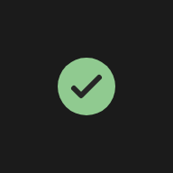 | 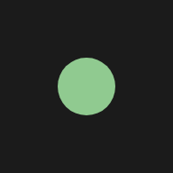 |
| warning | dark | rgb(238, 196, 72) | rgb(38, 38, 38) | 9.10:1 | 10.36:1 | 10.36:1 | 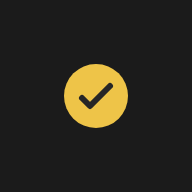 | 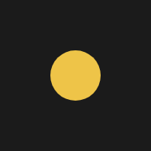 |
| error | dark | rgb(255, 174, 167) | rgb(38, 38, 38) | 8.55:1 | 9.73:1 | 9.73:1 | 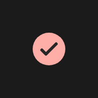 | 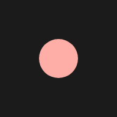 |
| accent | dark | rgb(241, 241, 241) | rgb(17, 17, 17) | 16.72:1 | 15.25:1 | 15.25:1 | 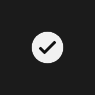 | 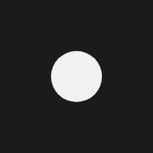 |
| neutral | dark | rgb(158, 158, 158) | rgb(38, 38, 38) | 5.65:1 | 6.43:1 | 6.43:1 | 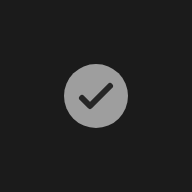 | 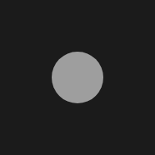 |

- Every ratio is above 3:1. The lowest mark-vs-fill ratio is 5.12:1, and the lowest dot-vs-panel ratio is 4.53:1 (both for success in light).
- Head and main compute the same fill, ink and panel colors for every variant: the pull request changes no color. Main draws no mark, so its crops show the fill alone.
- The pixels of each crop give the same ratios: the fill, ink and panel pixels equal the computed colors.

## 200% zoom

[head-light-success-zoom200.png](head-light-success-zoom200.png) is the head build at 200% browser zoom. That is a 640 × 400 CSS viewport at 2 device pixels per CSS pixel, in the same 1280 × 800 window. The dot stays 8 × 8 CSS px, with the 6 px mark 1 px from each edge. At this zoom, the docsite's preview panel also covers the second line of its "Canary docs" banner and most of the site header. The pull request does not touch that layout.

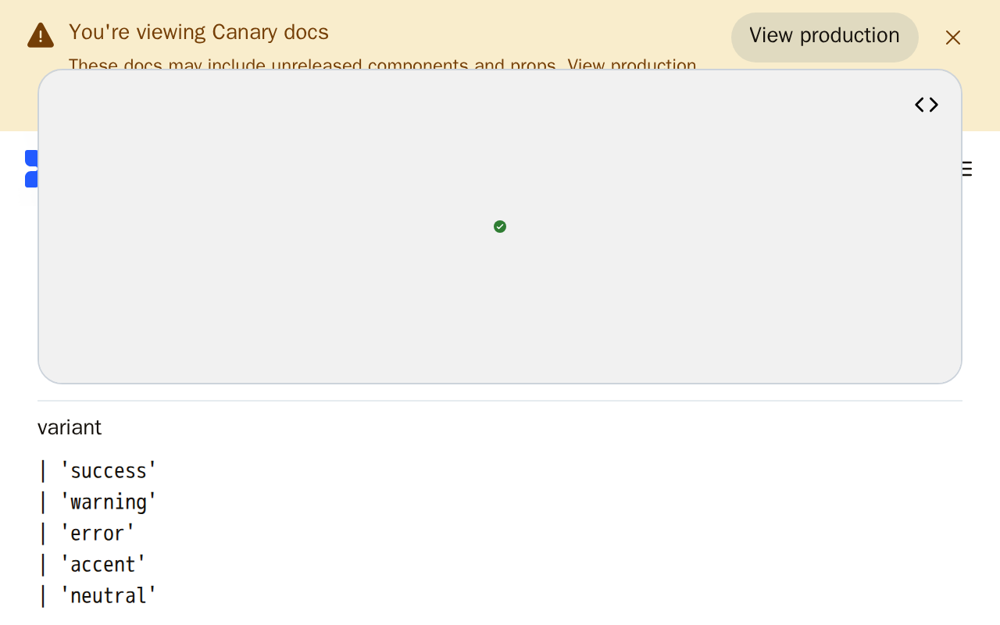

## The page

One frame per build at 1x, light, success: [head-light-page.png](head-light-page.png) (the icon switch on) and [main-light-page.png](main-light-page.png).

The docsite's web fonts come from Google Fonts, which the offline build could not reach, so the page text uses the fallback face. The dot and its mark do not depend on it.

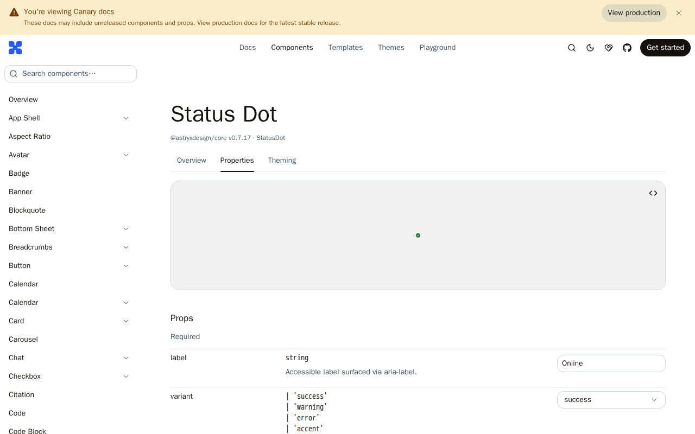

