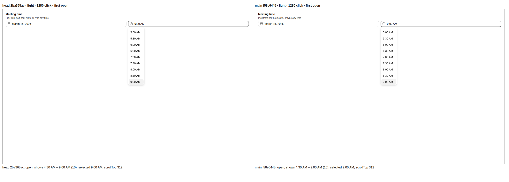
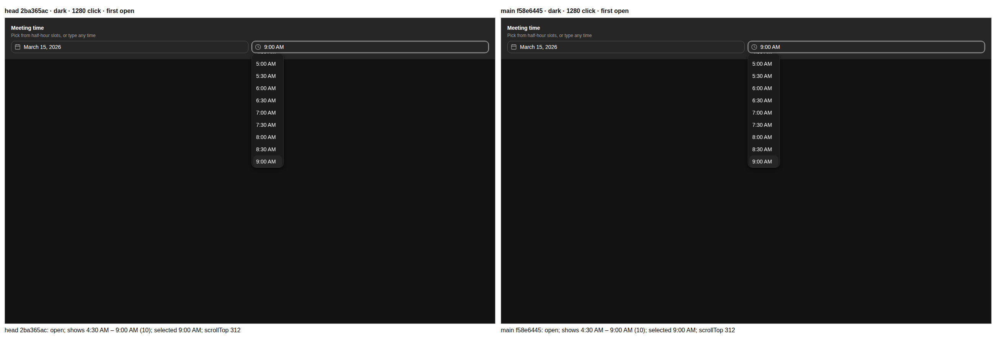
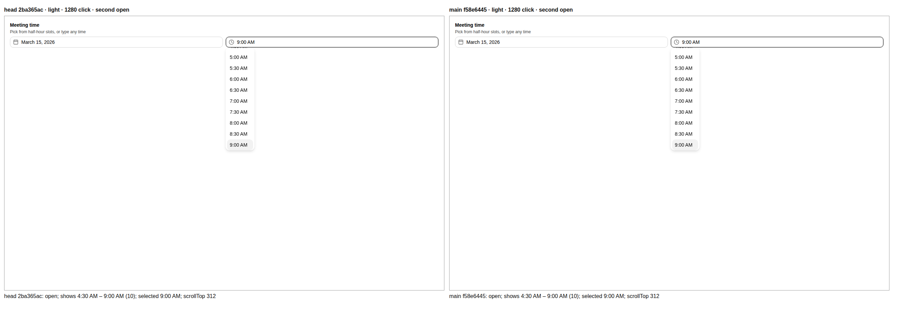
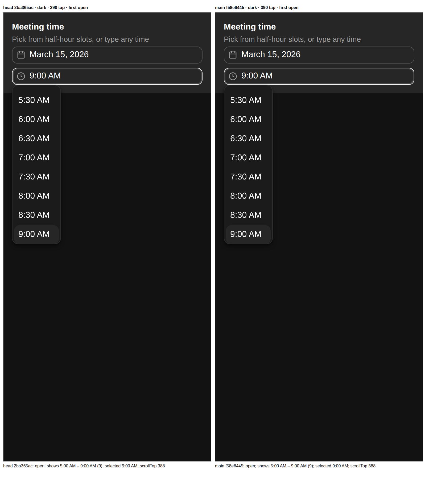
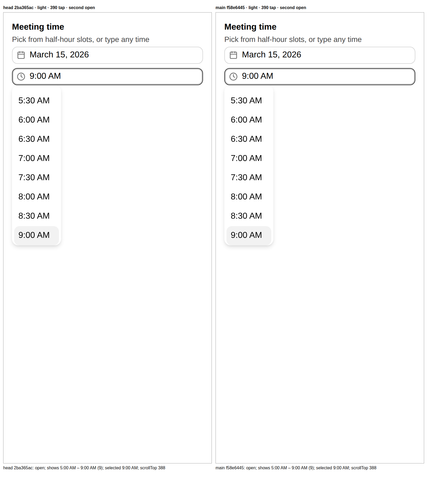
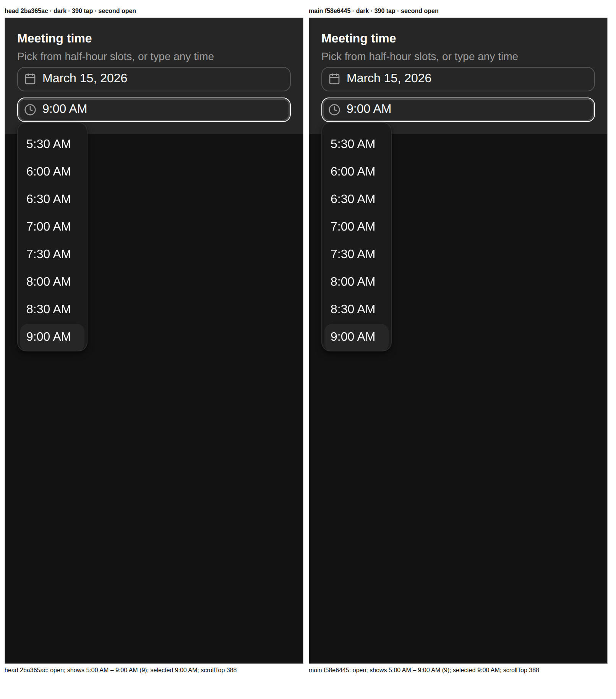

# DateTimeInput time list (#11776): first open, head vs main

Side-by-side frames of the time list's first and second open in the `Core/DateTimeInput` WithTimeOptions story. They come from two Storybook builds made the same way: meta/astryx #11776 at its head 2ba365ac (86cc1703 with main f58e6445 merged in), and main f58e6445. Each build is the repository's Storybook (`pnpm storybook:build`), served locally.

Chromium 149 opened the story in light and dark at 1280 × 800 with a mouse click, and at 390 × 844 with a tap. The tap uses Chromium's touch emulation, not a device. The page ran with reduced motion, with every animation and transition set to 0 s. In each image, head is on the left and main is on the right, and each caption names the build, scheme, width, gesture and open. Every number below was measured on those builds; [measurements.json](measurements.json) has them all.

## What each open shows

Head and main show the same options, selection and scroll position in every row, in light and in dark.

| Width and gesture | Open | List shows after | Options in view | Selected | Scroll position | Light | Dark |
|---|---|---|---|---|---|---|---|
| 1280, mouse click | first | 15–16 ms | 4:30 AM – 9:00 AM (10); 4:30 AM (38%) at the top edge | 9:00 AM, whole, and highlighted | 312 of 1244 |  |  |
| 1280, mouse click | second | 7 ms | 4:30 AM – 9:00 AM (10); 4:30 AM (38%) at the top edge | 9:00 AM, whole, and highlighted | 312 of 1244 |  |  |
| 390, tap (touch emulation) | first | 31–32 ms | 5:00 AM – 9:00 AM (9); 5:00 AM (33%) at the top edge | 9:00 AM, whole, and highlighted | 388 of 1436 |  |  |
| 390, tap (touch emulation) | second | 31–32 ms | 5:00 AM – 9:00 AM (9); 5:00 AM (33%) at the top edge | 9:00 AM, whole, and highlighted | 388 of 1436 |  |  |

- "List shows after" runs from the moment Playwright's click or tap returns to the first check that finds the list open. Checks run about every 25 ms, so these times are coarse.
- The scroll position is the list's `scrollTop` out of its largest value: 312 of 1244 at 1280, 388 of 1436 at 390.
- The list sits inside the viewport in every frame, and no option text is cut.
- The one partly hidden option is the first at the top edge, because the list scrolls to bring the selected 9:00 AM into view.
- For the second open, Escape closes the list and a press on a blank point moves focus away first.

## A note for review

In this story, the first click or tap opens the list on main too. The pull request's own test covers the case where React owns the document root. Its name is "opens on the first pointer click when React owns the document root". Storybook mounts each story in its own root element, so that case does not arise here. These frames show the pull request changes nothing visible in this story.
