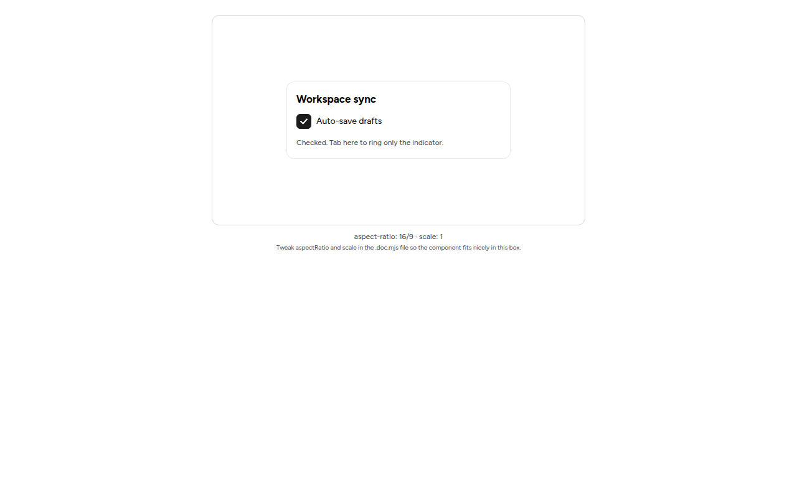
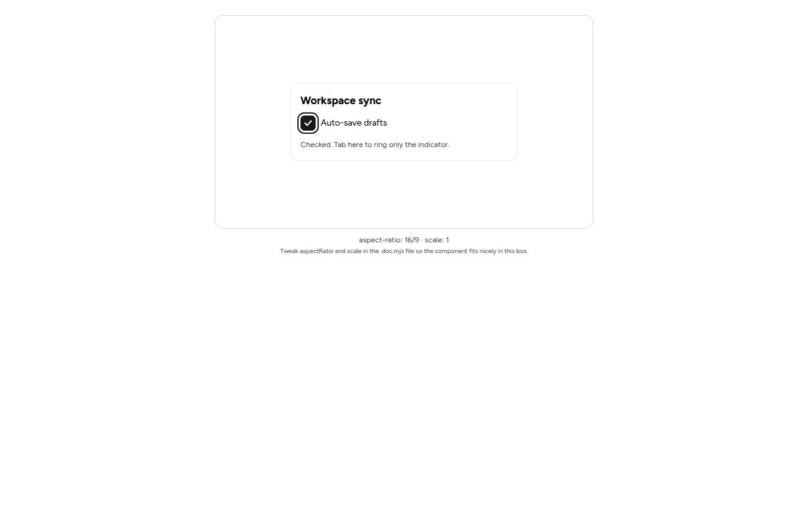
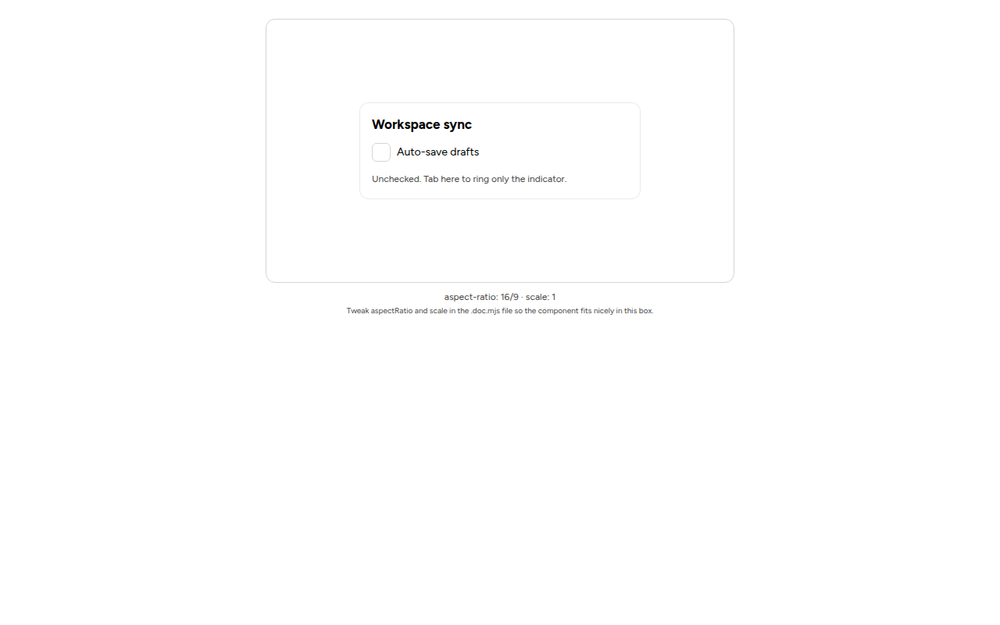
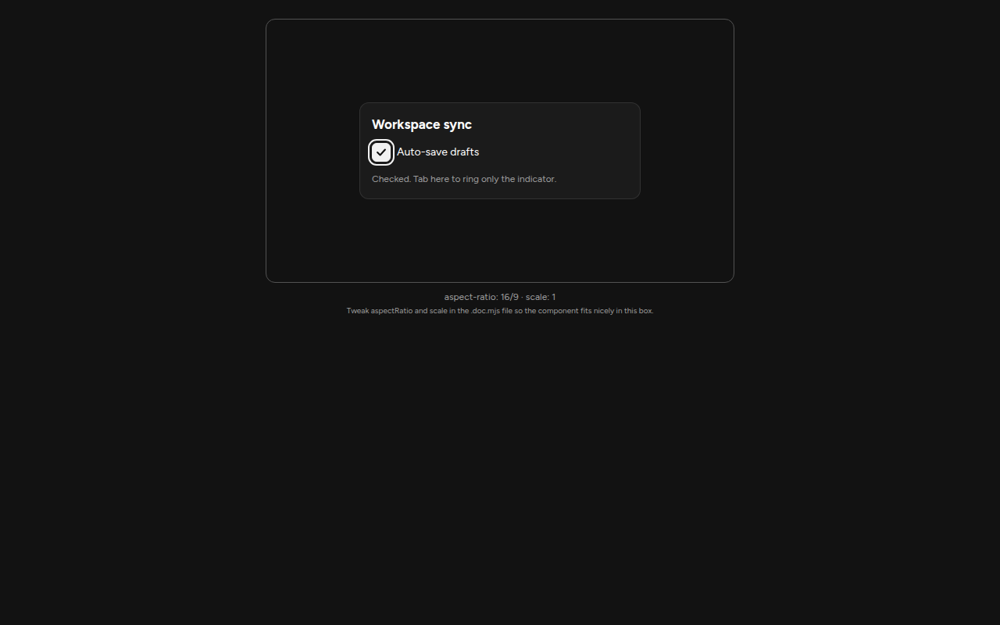
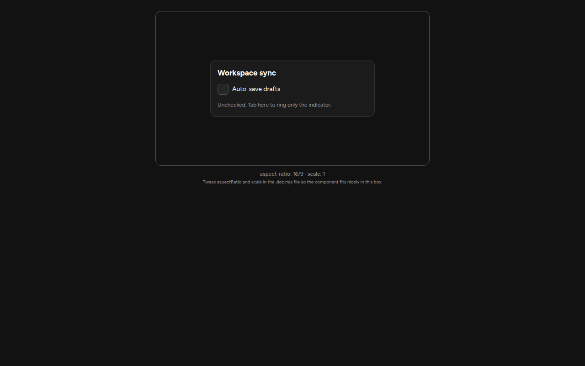

# useIndicatorFocusRing example block (#11373): focus-ring stills

Frames of the new `useIndicatorFocusRingHookUsage` example block from meta/astryx #11373 at 54a540ee, now the pull request's head: fc9cfb3a with main f58e6445 merged in. The same commit is the branch `l0/sandbox-11373`. Each frame is the page only.

The block comes from the repository's Sandbox app (`pnpm -F @astryxdesign/sandbox build`), served locally. Chromium 149 opened `/templates/useIndicatorFocusRingHookUsage/?embed=1&theme=neutral&mode=light` (and `mode=dark`) at 1280 × 800, with the neutral theme's own font files. Every number below was measured on that local build; [measurements.json](measurements.json) has them all.

## What each state shows

| State | Light | Dark | Focus | Ring |
|---|---|---|---|---|
| At rest | [light-1-rest.png](light-1-rest.png) | [dark-1-rest.png](dark-1-rest.png) | The page body | None on the indicator, its wrapper, the label or the input |
| After one Tab | [light-2-after-tab.png](light-2-after-tab.png) | [dark-2-after-tab.png](dark-2-after-tab.png) | The checkbox input, `:focus-visible` | The indicator only: `solid 2px` at offset `3px`, in the ink color (rgb(27, 27, 27) in light, rgb(241, 241, 241) in dark) |
| After a pointer click on the row | [light-3-after-click.png](light-3-after-click.png) | [dark-3-after-click.png](dark-3-after-click.png) | The checkbox input, not `:focus-visible` | None. The box unchecks, and the line below reads "Unchecked. Tab here to ring only the indicator." |

- One Tab from the page reaches the checkbox.
- Between rest and after Tab, 292 pixels change, all inside a 34 × 34 box around the 24 × 24 indicator (the ring and its offset). The label row is 328 px wide, and none of it outside that box changes. Light and dark measure the same.
- The visually hidden native input covers the whole 328 px row and reports its own `auto 1px` focus outline. No pixel outside the indicator's ring box changes, so that outline paints nothing.

## Frames

### Light, at rest

### Light, after one Tab

### Light, after a pointer click

### Dark, at rest

### Dark, after one Tab

### Dark, after a pointer click

