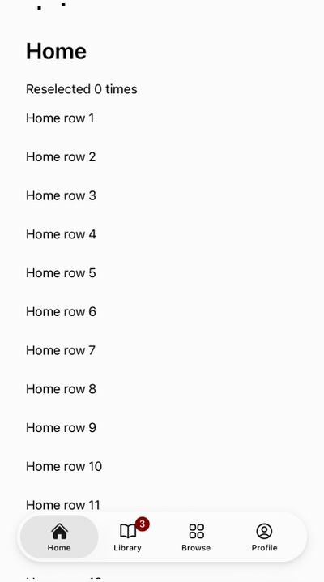
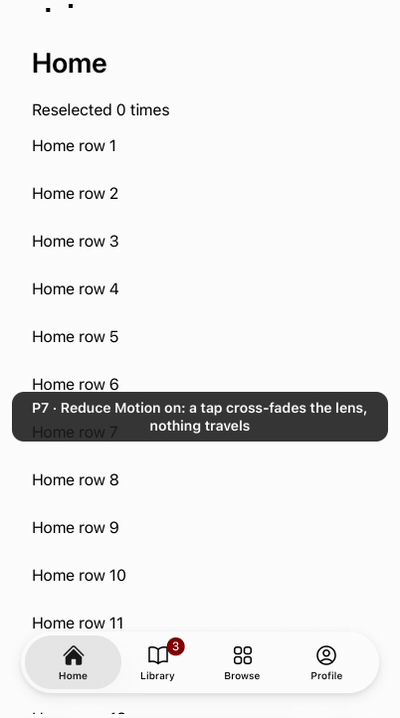
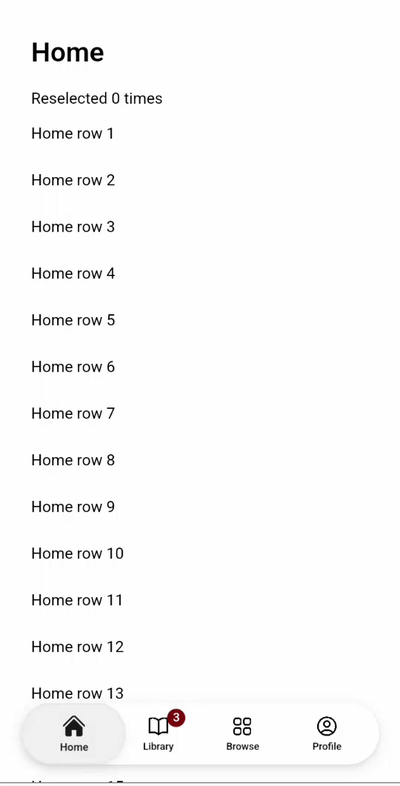

## User need

Phone apps on Astryx need iOS 26's bottom tab bar: the top-level sections in a floating capsule, with a lens that answers a finger as UIKit's does. A composed tab list slides on the theme's curve and ignores a finger's press and drag.

## Evidence

    

Recorded from the drafts this replaces (iOS 26.2 simulator, Android emulator); only the imports differ.

## Problem and solution fit

Under a finger the lens lifts into glass, follows a drag and settles on the tab nearest the lift, on UIKit's springs, while the bar flexes. Under a mouse or a pen a click chooses a tab on the theme's motion. A drag carries the lens and its release chooses; off the bar it chooses nothing. Choosing the selected tab again calls `onReselect`.

## Current specification

- **Lab:** Lab is not shipped; no record governs TabBar.
- **CLI:** `astryx discover` lists TabBar because `official-packages.json` is regenerated from the repository, as `spec:AST-051` FR11 requires.

## Owner decisions

1. `family:action-groups`: TabBar meets FR1 and FR2. Under a finger it departs from FR3 as UIKit does: a lift off the bar chooses the nearest tab. Under a mouse or pen, sliding off cancels.
2. `spec:AST-094` FR4: the lens plays UIKit's measured springs from `uikitTabBar.ts`, not motion roles, until promotion names roles.
3. `spec:AST-017` FR60: under a finger, a copy of the items rides in the lens while it moves (2 + 4 elements per item, 18 for four tabs). None renders at rest.
4. `spec:AST-017` FR59: a mouse or pen drag moves the resting lens on the theme's transition, with no lift and no copy (`spec:AST-094` FR43).

Also: the lens tracks with its own recognizer, since Lab can't import Core's internal `actionGroupTracker`; promotion adopts it. `TabBarItem` has no disabled prop here, and `@astryx/disabled-cursor` requires the cursor rule. The gesture host's coarse-pointer gate and `perEventPointer` stay Core's, unchanged.

## Public delta and caller burden

New Lab exports `TabBar` and `TabBarItem`, with their props types:

```tsx
<TabBar value={tab} onChange={setTab} onReselect={popToRoot} label="Sections">
  <TabBarItem value="home" label="Home" icon={<Icon icon={HomeIcon} />} />
</TabBar>
```

## Design and alternatives

- Layout is CSS: right before hydration and through a resize.
- Under a finger the lens runs on Core's animator, on the compositor. Under a mouse it is a CSS transition.

## Scope

- [x] One capability is added.
- [x] Unrelated fixes, cleanup, and policy changes were removed or split.
- [x] Consumer docs, focused tests, and migration evidence ship with the feature.
- [x] Public text and artifacts contain no internal Meta context.

## Testing

Local gates at f277ee0d26 (on the Core part and the page freeze, over #9399's 1748182dbf), node 24.22.1 from `.nvmrc`:

1. **Interaction specs, built Storybook:** Chromium 42/42; WebKit 36 passed, 6 skipped (Chromium-only evidence: CDP traces and scripted touch times).
2. **Busy main thread:** the slide's proof on a two-core pin, one worker, ×10: 10/10. Each run is judged against the harness's compositor control, so a stall the compositor makes itself fails the control too.
3. **Scene clock:** the drag's chase law and the finger landing before the last lift run on the page freeze, at scripted instants. A mutant chase (`lensTrack` response 0.3) fails the chase case by 44 px in both engines. Real-time following under load is the busy proofs' job.
4. **Red-first, this PR:** focus after a mouse slide inside an iframe stayed on the pressed tab with the old global-document reading; the iframe unit test now passes.
5. **Unit and static:** 81 unit tests (TabBar, its model, its UIKit table's sources, the CLI official list); Lab typecheck; strict ESLint, 0 problems; Changesets; i18n catalog; docsite data with the ShadCN route lock.

Batch: L1 · Lab: iOS chrome (TabBar, SearchField, NavigationStack, PageControl)

Size: 4,861 added lines, about half tests. Minimize through More follow in a second batch.

Supersedes #8129, #8141 and #8703.

Needs #9399, PCORE_PR and PFREEZE_PR; rebases onto main as they merge.
