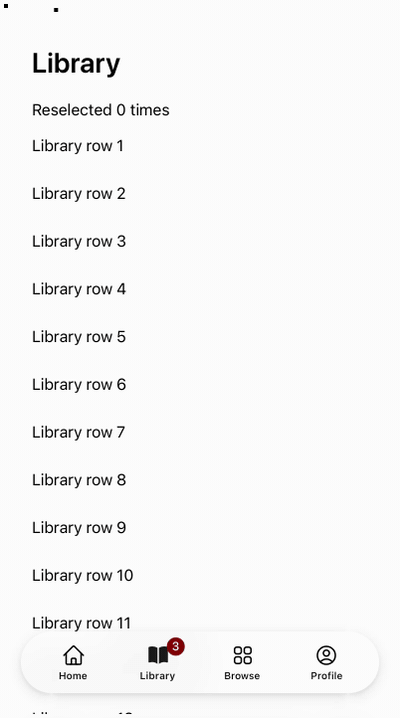
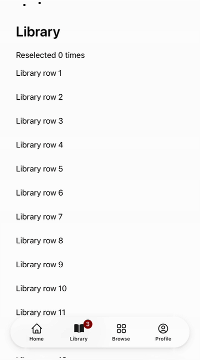
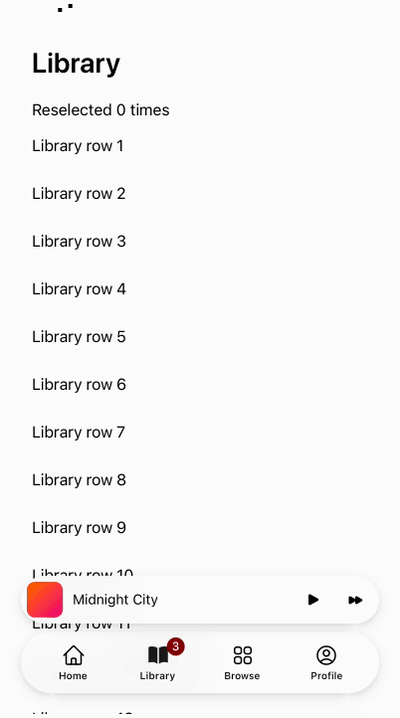
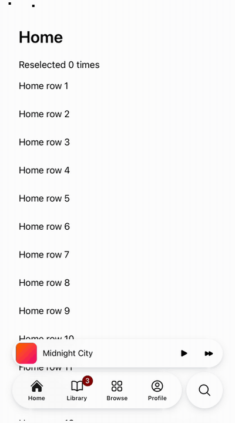
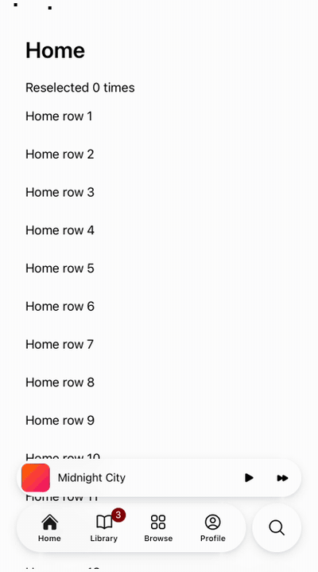
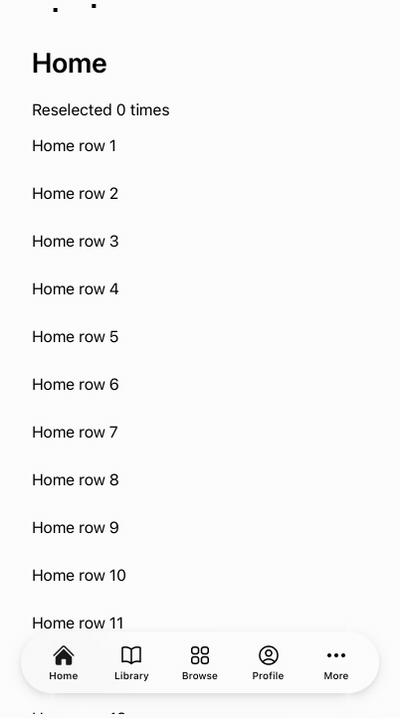
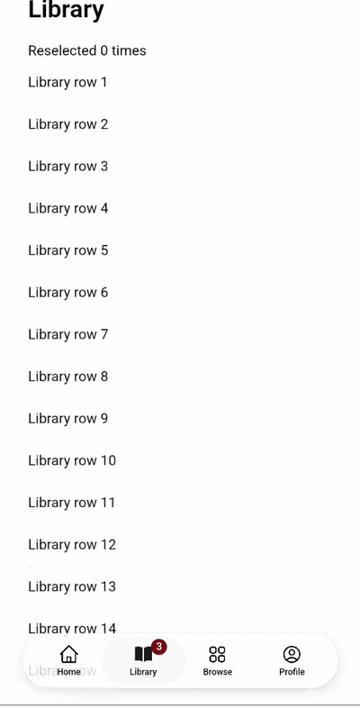

## User need

On iOS 26 a tab bar gets out of the way as the page scrolls, holds a bottom accessory such as a mini player, keeps search one tap away, and folds extra sections into a More tab. On Astryx each is built by hand, without UIKit's motion.

## Evidence

      

Recorded from the drafts this replaces (iOS 26.2 simulator, Android emulator). Since then the field reads the keyboard from the visual viewport only, and a drag over a disabled tab returns the lens to the selected tab.

## Problem and solution fit

- `minimizeBehavior="onScrollDown"`: a finger's downward scroll collapses the bar into a circle; the top or a tap expands it.
- `bottomAccessory`: content above the bar that moves beside the circle.
- `isDisabled` on an item: visible, never chosen.
- `TabBarSearchTab`: a circle whose field rises above the keyboard, the circle then Cancel.
- `moreValue` and `TabBarMoreList`: past five tabs, four plus More.

## Current specification

- **Lab:** Lab is not shipped; no record governs TabBar.
- **CLI:** `astryx discover` lists TabBarSearchTab and TabBarMoreList because `official-packages.json` is regenerated from the repository, as `spec:AST-051` FR11 requires.

## Owner decisions

1. Minimizing is finger-only: a mouse-driven bar stays expanded. `minimizeFade` is a guess (`@measure M-TB1`) until measured.
2. The accessory, minimize and search springs play UIKit's measured values, not motion roles (`spec:AST-094` FR4).
3. Disabled tabs: a finger landing on one moves nothing; over one the lens returns to the selected tab (`family:action-groups` FR2).
4. Collapsed, the bar is one button named after the selected tab.
5. More: first four plus More; More again while it holds a tab is a reselect.
6. Cancel grows while pressed and wobbles back, as UIKit's does.
7. The first batch's four decisions carry over.

Also: each glass (accessory, search field) is three elements: an `aria-hidden` containing block that draws the start cap, and two pieces the motion animates by ref. The finger-only code is 6.5 KB gzip of TabBar's 12.6 KB.

## Public delta and caller burden

New Lab exports `TabBarSearchTab` and `TabBarMoreList`; `TabBar` gains `minimizeBehavior`, `bottomAccessory` and `moreValue`, and `TabBarItem` gains `isDisabled`. All optional; a bar without them is unchanged.

## Design and alternatives

- Only the person's scrolling counts toward minimizing, as on iOS.
- The search field stays mounted, so the choosing tap can focus it.

## Scope

- [x] One capability is added.
- [x] Unrelated fixes, cleanup, and policy changes were removed or split.
- [x] Consumer docs, focused tests, and migration evidence ship with the feature.
- [x] Public text and artifacts contain no internal Meta context.

## Testing

Local gates at e3d3436f76 (on the first batch), node 24.22.1 from `.nvmrc`:

1. **Interaction specs, built Storybook:** Chromium 106/106; WebKit 92 passed, 14 skipped (Chromium-only evidence skips itself).
2. **Two-core pin:** the whole spec at four workers ×2, 212/212; the three busy-main-thread proofs (slide, collapse, accessory) at one worker ×10, 30/30, each judged against the harness's compositor control.
3. **Red-first, this PR:** over a disabled tab, the new finger and mouse cases failed on the previous build, with the lens 89 px and 255 px from the selected tab.
4. **Unit and static:** 165 unit tests (TabBar, its model, its UIKit table's sources, the entry, the CLI official list); Lab, Core and harness typecheck; strict ESLint, 0 problems; Changesets; i18n catalog and runtime; docsite data with the ShadCN route lock; repository checks. The provenance baseline check fails only on main's four stale entries.

Batch: L1 · Lab: iOS chrome (TabBar, SearchField, NavigationStack, PageControl)

Size: 6,619 added lines, about half tests.

Supersedes #8154, #8172, #8192, #8210, #8222, #8243 and #8248.

Stacks on A_PR; needs #9399, PCORE_PR and PFREEZE_PR; rebases as they merge.
