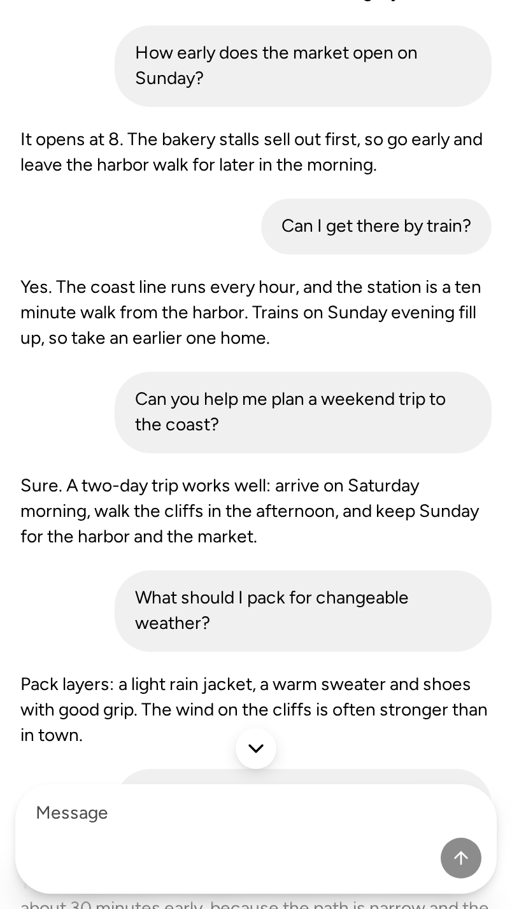
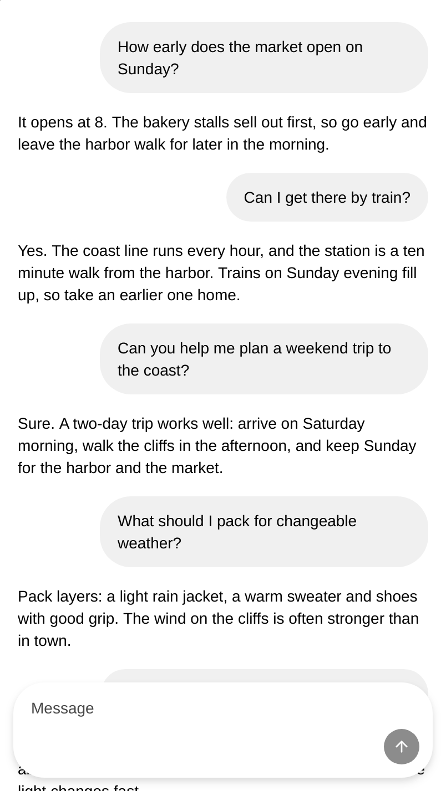
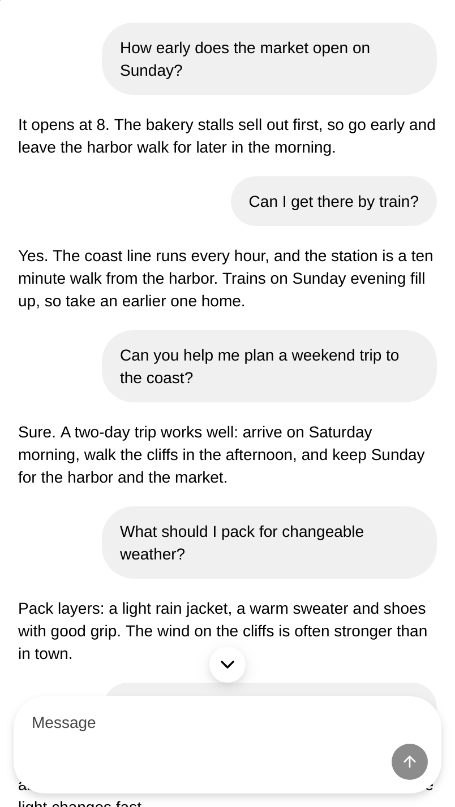

## User impact

A chat that scrolls the whole page passes ChatLayout the document's scroller as `scrollRef`. There, two things fail on main:

- The scroll-to-bottom button never appears when the reader scrolls up.
- Follow never stops. While a reply streams, each new chunk pulls the reader back to the newest message.

A reader cannot read back during a reply, or return to the end with the button.

## Problem and solution fit

- **Why does it fail?** `useChatStreamScroll` listens for `scroll` and `scrollend` on the element it scrolls. A browser fires a page's scroll at the document instead, so the hook never hears the reader.
- **Why would it still fail with the event?** The hook measures the distance to the end with `offsetHeight`. For the root element, that is the page's height, so the distance never passes the button's threshold.
- **Why does it matter?** The record allows `scrollRef` to name the document element, and phone transcripts often scroll the page.
- **The fix:** for the document's scroller, the hook hears the document's `scroll` and `scrollend` through the shared input stream. It measures the root by its `clientHeight`, the viewport.

## Expected behavior and authority

- `component:ChatLayout`, end-user impact: it "offers a scroll-to-bottom affordance when the reader has moved away from the bottom".
- Its FR6: an omitted `scrollButton` "selects the wired default".
- Its representative state "External `scrollRef`": "The named element may be the document element".
- The hook's own contract: "Scrolling up (any source): unlocks immediately" and "Scrolling settles at bottom: re-locks on scrollend".

No record changes.

## Smallest restoration

Only `useChatStreamScroll.ts` changes, with no new API, prop, default or visual change. Element scrollers keep their listeners and their `offsetHeight` measure. The input stream's window listener hears every element's scroll, so the hook takes only the document's.

## Evidence

- **Reproduction before the change**, at main fa30cff134, in Chromium and WebKit: after a wheel scroll up on a page-scrolling transcript, the button's signal stays off. New messages then pull the page back 870 to 883 px.
- **Result after the change:** the signal turns on, follow stops, and the page stays put. All 3 cases pass 5 runs in each engine.
- **Representative unchanged path:** an element scroller, whose existing hook units pass unchanged.
- **Mutation-sensitive proof:** four mutants each fail a unit: no document filter, an `offsetHeight` root, a root-element listener, no `scrollend`.

## Scope

- [x] One defect is restored.
- [x] Separable contradictory or unsettled tagalongs were removed or split.
- [x] No new public API, visual representation, default, or interaction model is hidden under the bug-fix label.
- [x] Public text and artifacts contain no internal Meta context.

## Testing

- `pnpm exec vitest run --project ui packages/core/src/Chat/`: 496/496 at 45130f992c. New: four hook cases for a page scroller and one ChatLayout case. On main, the hook case "shows the scroll button and stops following when the reader scrolls the page up" and the ChatLayout case fail.
- `useChatStreamScrollPage.a11y.browser.spec.ts`, new, in Chromium and in WebKit: 3/3 in each of 5 runs per engine at 45130f992c. On main, 2 of 3 fail in each engine, in each of 2 runs.
- `pnpm exec tsc` and ESLint: clean. `pnpm review:pre`: 0 findings, and the branch merges clean with main.
- The sandbox Chat Layout page at `?case=long`, where the page scrolls its document, built at 45130f992c and with main's hook. After a 600 px wheel scroll up from the end, the button stays hidden on main and shows with the fix, in Chromium and in WebKit:

| Engine | main | fix |
| --- | --- | --- |
| Chromium |  |  |
| WebKit |  |  |
