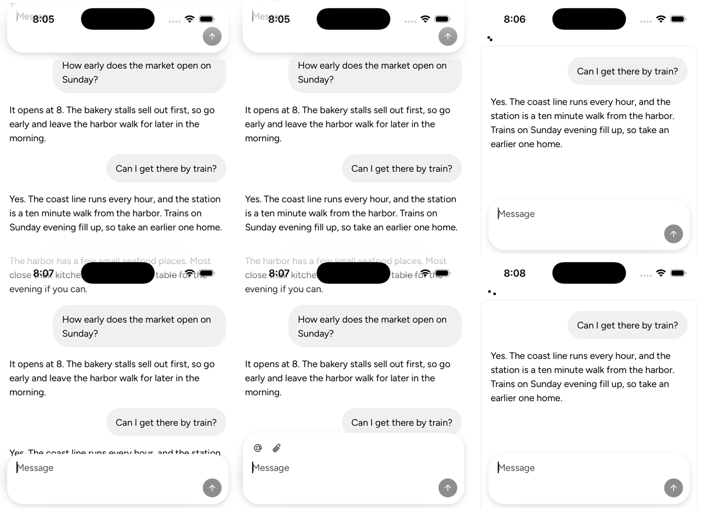
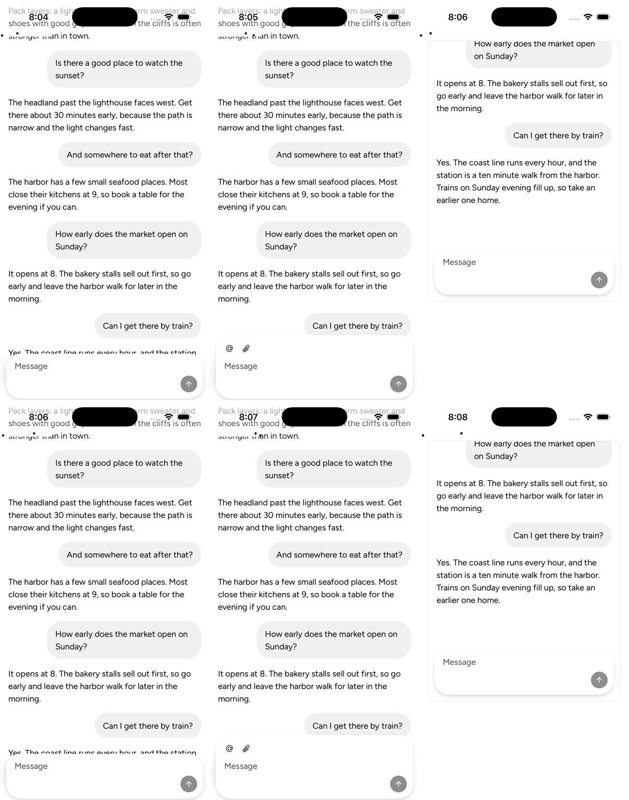
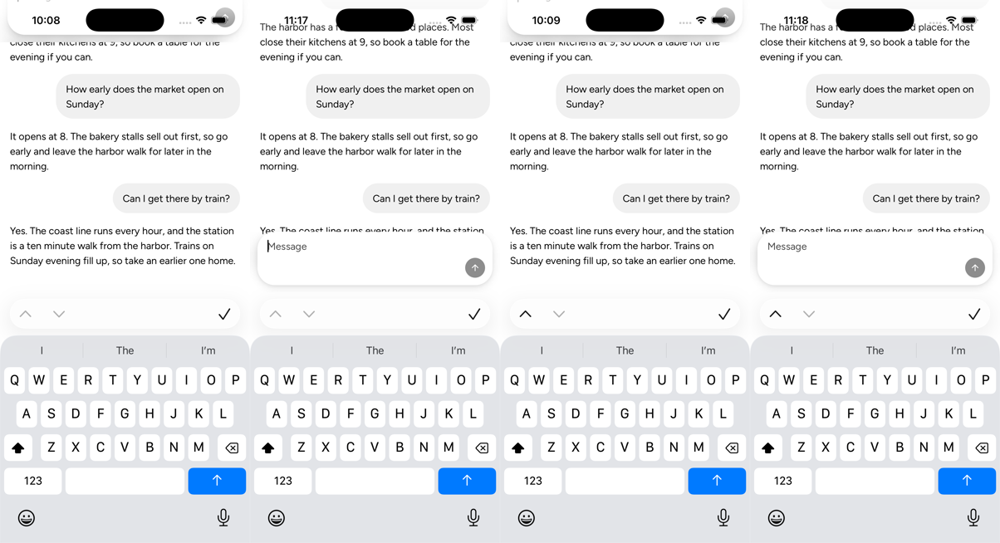
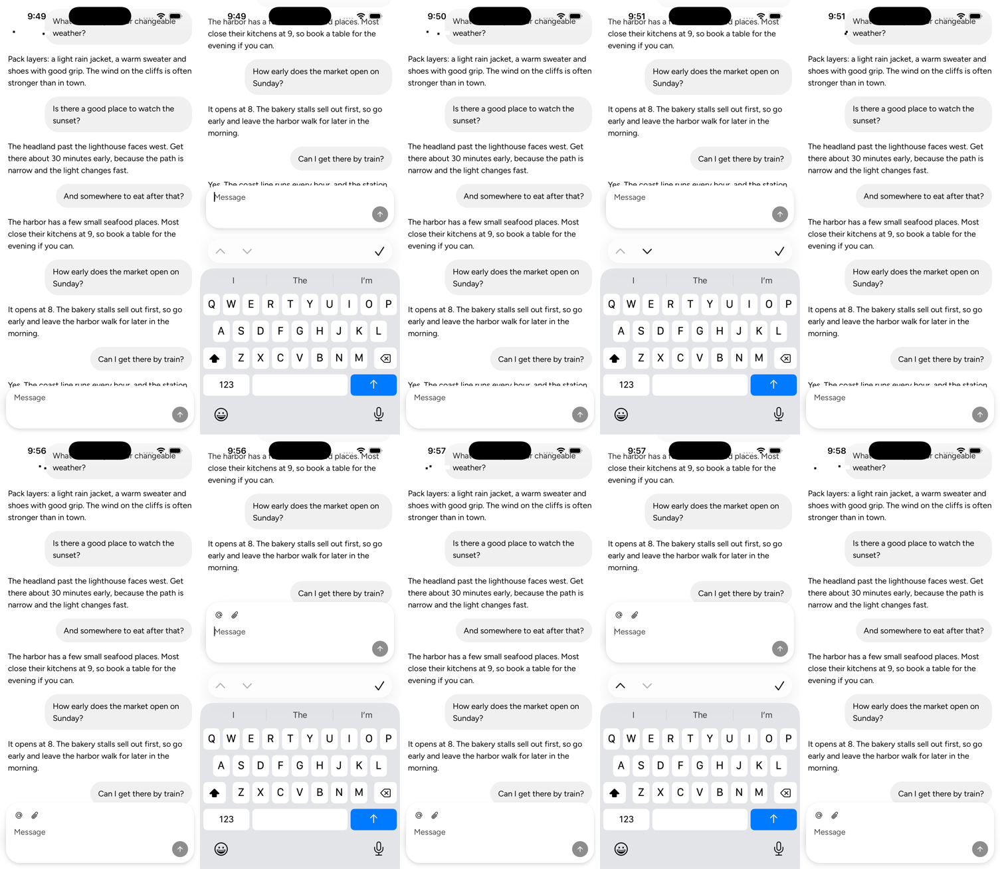

<!-- Template: bug-fix.md -->
Review only this pull request's change: https://github.com/vjeux/astryx/compare/0d755730457931688c2a51408fb142593aa49306...e391719bba568f7ea3b20a44500be8cb1c58d684

## User impact

In Safari on iOS, tapping the composer of a ChatLayout whose `scrollRef` is the document puts it under the status bar.

## Problem and solution fit

In a page that scrolls the document, Safari pans the visual viewport to the fixed dock when the keyboard opens, and keeps the pan. ChatLayout's lift adds to it. Firefox for Android does not pan, so it needs that lift.

Three narrower fixes failed on the Simulator. A lift less Safari's pan made Safari pan again at each change. Re-arming the put-back after ChatLayout's scroll left the pan in place. No lift with the tap claim kept left the composer under the keyboard: Safari then never panned.

## Expected behavior and authority

`spec:AST-099` FR3 puts a docked composer on the keyboard; FR4 keeps focus from panning the page. FR3 and FR4 now name two exceptions: Safari on iOS, and a page's first keyboard show in another browser without the VirtualKeyboard API. Two Firefox verification rows and Gap 16 cover that show. They need the spec owners' stamp at this head.

## Smallest restoration

When `scrollRef` names the document's root or body, without the VirtualKeyboard API, the first keyboard show leaves focus to the browser. The keyboard module's reveal-pan watch decides that show, under a new `dock` option that is off by default. A pan to the dock means no lift. A dock still covered 0.7 s after the keyboard's report rises, and that page then works as on main. Only a pan restarts that wait, up to 3 s. Chrome and self-scroll mode are unchanged.

## Evidence

- Reproduction before the change (iOS 26.2 Simulator, #10672's page): a tap puts the dock's top at −102 px in `long`, −138 px in `composer`.
- Result after the change: the dock's bottom meets the keyboard at 377 px.
- Representative unchanged path: `docked`, and every case with no keyboard (Testing).
- Regression test or other mutation-sensitive proof: new cases on scripted time fail on main, and each gate's removal fails its own case (Testing).
- Captures, main first; the README maps each (https://github.com/vjeux/astryx/tree/e3601264cc50a221be53b41cb62d999372af1040):

  
  
  
  

## Scope

- [x] One defect is restored.
- [x] Separable contradictory or unsettled tagalongs were removed or split.
- [x] No new public API, visual representation, default, or interaction model is hidden under the bug-fix label.
- [x] Public text and artifacts contain no internal Meta context.

## Testing

- `useChatKeyboard.test.tsx` and `keyboardHeight.test.ts` script time, touches and visual-viewport values:
  - No pan with a 290 px keyboard: no lift at 650 ms, then 290 at 700 ms after the report. The height reports of the keyboard's slide don't extend the wait. The next show lifts at once, with the focus takeover.
  - A pan of 337 at 300 ms: no lift and no takeover, at that show and the next. A smaller pan restarts the wait.
  - Already revealed at the report with no pan: no lift, and nothing learned.
  - A reveal pan after the wait, with no touch or wheel since the show's report, drops the lift once. After a touch, a wheel, a resize report mid-drag, or at a later show, the lift stays.
  - Pans that keep restarting the wait end at the 3 s cap, which teaches nothing.
  - The tap claim, `focus()`'s reveal and the put-back each have a case before and after a page learns the dock is covered. Removing any one gate fails its case.
  - With the option off, the reveal-pan watch reports and listens as before. Two windows learn on their own. With the VirtualKeyboard API nothing is watched.
  - The cases fail on main. Chat, keyboard, utils and BottomSheet units: 2405/2405.
- No keyboard: Chromium and WebKit's CI container, phone and desktop, read the same dock and message offsets on both builds. So does the Simulator.
- The iOS home-screen app, on the Simulator, on a build of d0516270ff: a tap, Done, Next from a probe field, and `focus()`. Each keyboard route rests the composer on the keyboard, and Done leaves no group. On main, a tap and Next put it off screen.
- Core tsc, ESLint, `check:knowledge` and `check:changesets` pass.
- The browser frames come from 8bb22d9c95 (banked on the fork) with #10672's page. A build of d0516270ff reads the same in Safari: 235 px in `long`, 199 px in `composer`.
- This head moves the watch into the keyboard module, with no per-frame reads. Safari's path decides as before: its pan came 0 to 384 ms after the report in 13 Simulator runs.

## Release check

1. Red-first: the frames and unit cases above.
2. #8176 caused it. After a tap in `long`, the dock's top reads 235 px on 33bc644a (before #8176) and on main with #8176 reverted. It reads −102 px on 695653f5 (#8176) and on the release candidate c99ad4aa.
3. Who sees it: every composer tap in a ChatLayout whose `scrollRef` is the document, in Safari on iOS.
4. The cost, accepted for v0.7.12: in Firefox for Android, the first keyboard show on each page covers the composer for about 0.7 s after the keyboard's report. Later shows lift at once. Chrome never takes this path. The follow-up is #10703.
5. Maintainers' ruling, 2026-11-08: a slow-device Firefox take at this head must show a first-show cover of 1.5 s at most, and Gap 16 then records the measured value. Firefox for Android evidence at this head: pending.

## Writing rubric results

`spec:AST-099` FR3, FR4, FR9's docked-container clause, the two Firefox rows and Gap 16:

- R2: Gap 16 states the Simulator's measured pan timing (0 to 384 ms). Kept: Spec owners' ruling, 2026-11-08.
- R4: Gap 16 states why a short first-show cover beats a lift and then a drop. Kept: Spec owners' ruling, 2026-11-08.
- R1, R3, R5, R6: none.

