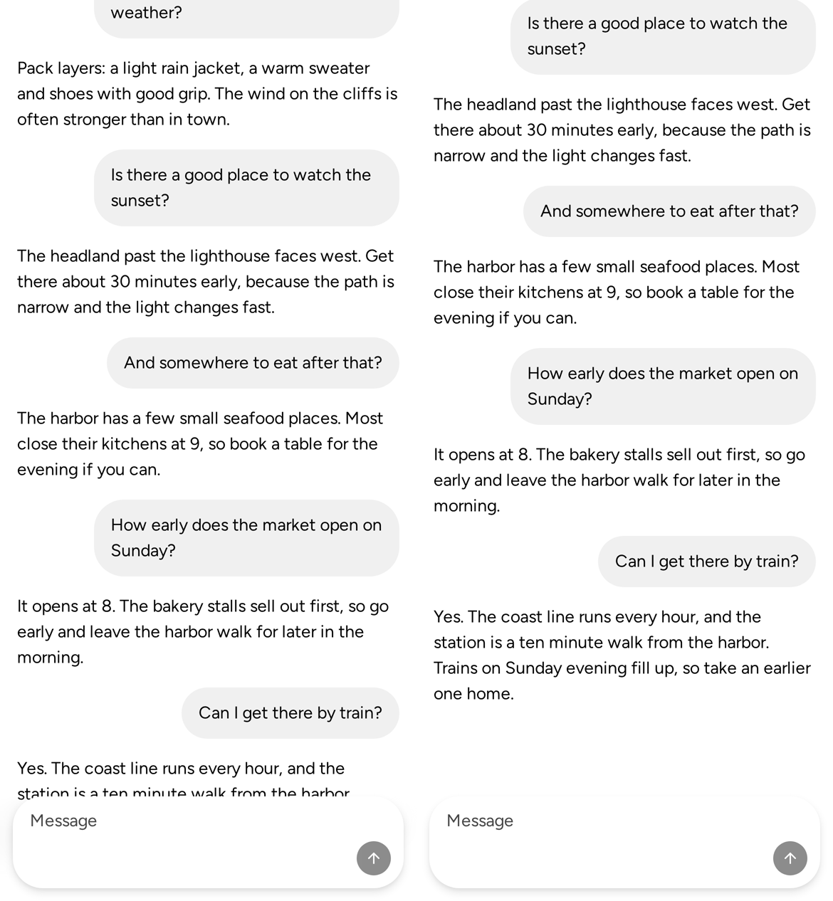
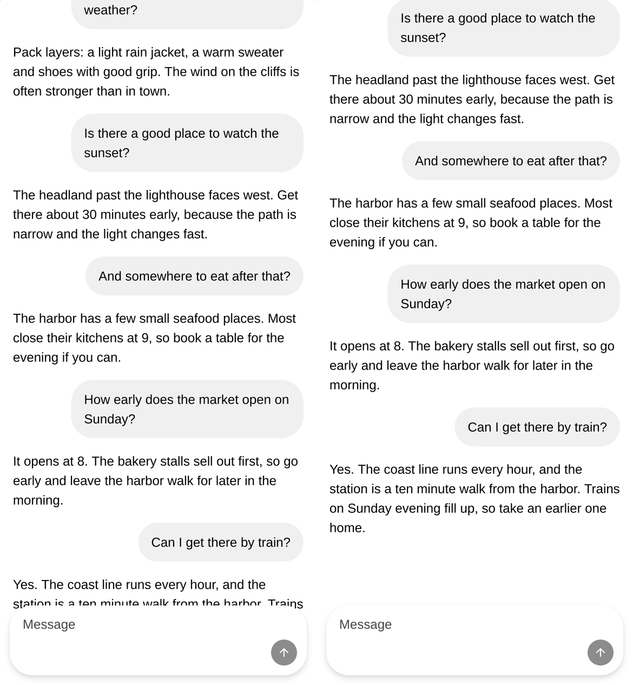
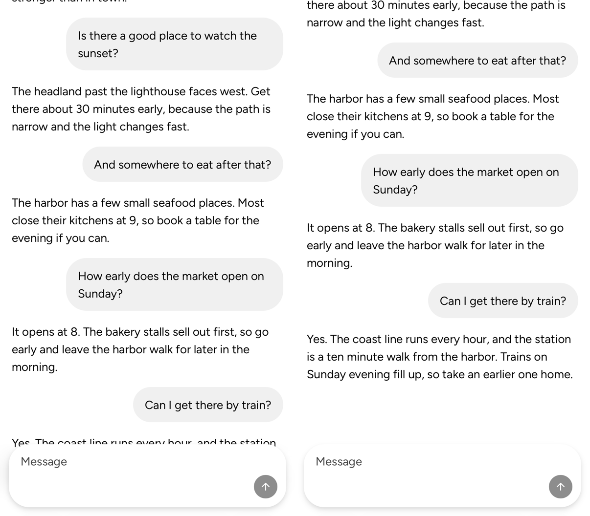

<!-- Template: bug-fix.md -->
Stack: #10672 → #10676

Review only this pull request's change: https://github.com/vjeux/astryx/compare/b468198b99f61c96aa4dd20fd8465cd094dee02c...c752dfd366078803c79ac4d6b16a5b46e830d11b

## User impact

A ChatLayout whose `scrollRef` names an outer scroller, such as the document, hides its newest message under the composer. At the scroll's end its last 102 px sit under the 142 px dock, more under a taller composer. A streamed reply ends out of sight.

## Problem and solution fit

With a `scrollRef` the dock is fixed and out of flow (FR4). The message area pads its end by 24 px and the message list by 16 px. So 142 − 24 − 16 = 102 px stay under the dock. In self-scroll mode the in-flow dock leaves the newest message 40 px above it. The fix gives the fixed dock the same room.

## Expected behavior and authority

`component:ChatLayout` FR4 now requires the message area's end padding to hold a fixed dock's height. PR1 notes that the height reaches the layout through PR2's pooled observer. Both need the spec owners' stamp.

## Smallest restoration

In `scrollRef` mode only, ChatLayout observes the dock's border-box height through the pooled `observeResize`. It adds that height to the message area's end padding, beside the keyboard's lift. The padding changes only the message area, so it never resizes the dock. No new prop or type; self-scroll mode is unchanged.

## Evidence

- Reproduction before the change, at the document's end on #10672's page: in `long` and `streaming` the newest message sits 102 px under the dock. Chromium and WebKit agree. In `composer` (a 178 px dock) it is 138 px on a phone and 112 px on a desktop. After three more lines it is 168 px. On the iOS 26.2 Simulator it is 102 and 138 px.
- Result after the change: the message rests 40 px above the dock in every case, after the composer grows, and on the iOS Simulator.
- Representative unchanged path: `?case=docked` (self-scroll) stays 40 px above on both builds and observes nothing.
- Regression test or other mutation-sensitive proof: two `ChatLayout.test.tsx` cases fail on main's `ChatLayout.tsx`. The dock's resize callback runs once at mount, not again in an idle second.
- Captures, main left and the fix right (https://github.com/vjeux/astryx/tree/6db48c909bbeab913b389a4a55f0e062d28a03ea):

  
  
  

## Scope

- [x] One defect is restored.
- [x] Separable contradictory or unsettled tagalongs were removed or split.
- [x] No new public API, visual representation, default, or interaction model is hidden under the bug-fix label.
- [x] Public text and artifacts contain no internal Meta context.

## Testing

- `ChatLayout.test.tsx`: room for a fixed dock (142 px), none in self-scroll mode, and the room follows a dock that grows to 166 px. Chat units 485/485.
- Core tsc, ESLint, `check:knowledge` and `check:changesets` pass.
- The browser matrix above runs on Sandbox builds of main with #10672 and of c752dfd366, in Chromium and in WebKit's CI container. The captures were taken at 049231840d, the same room before the callback-ref move.

## Release check

1. Red-first, at the document's end with no keyboard: main reads the newest message 102 px under the dock in `long`. It reads 138 px on a phone and 112 px on a desktop in `composer`. This head reads it 40 px above. Chromium and WebKit agree, phone and desktop.
2. With the keyboard open in Safari on the iOS Simulator, main's double lift (#10690) hides the dock. With #10690's commit applied too, this head reads 40 px above in `long`, `composer` and `docked`.
3. #8176 did not cause it. The same 102, 138 and 112 px read on 33bc644a (before #8176) and on 695653f5 (#8176). They also read on the release candidate c99ad4aa and on main with #8176 reverted locally. Chromium and WebKit agree, phone and desktop.
4. Who sees it: every ChatLayout whose `scrollRef` names an outer scroller, such as the document, in every browser. A self-scroll ChatLayout is not affected.

## Writing rubric results

`component:ChatLayout` FR4, PR1 and the verification row: R1–R6 none.
