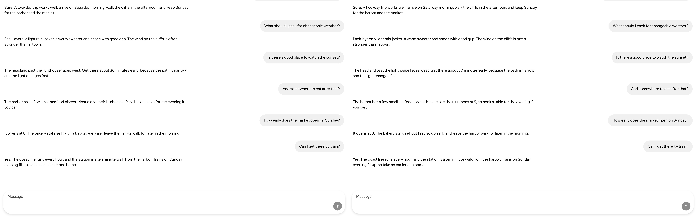
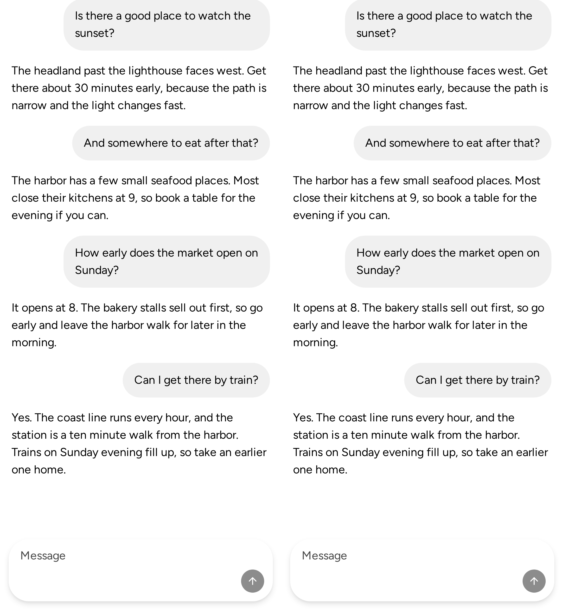
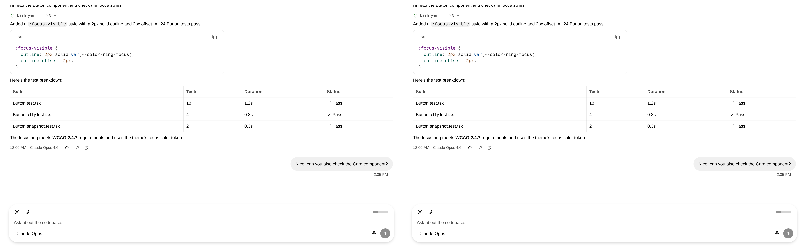
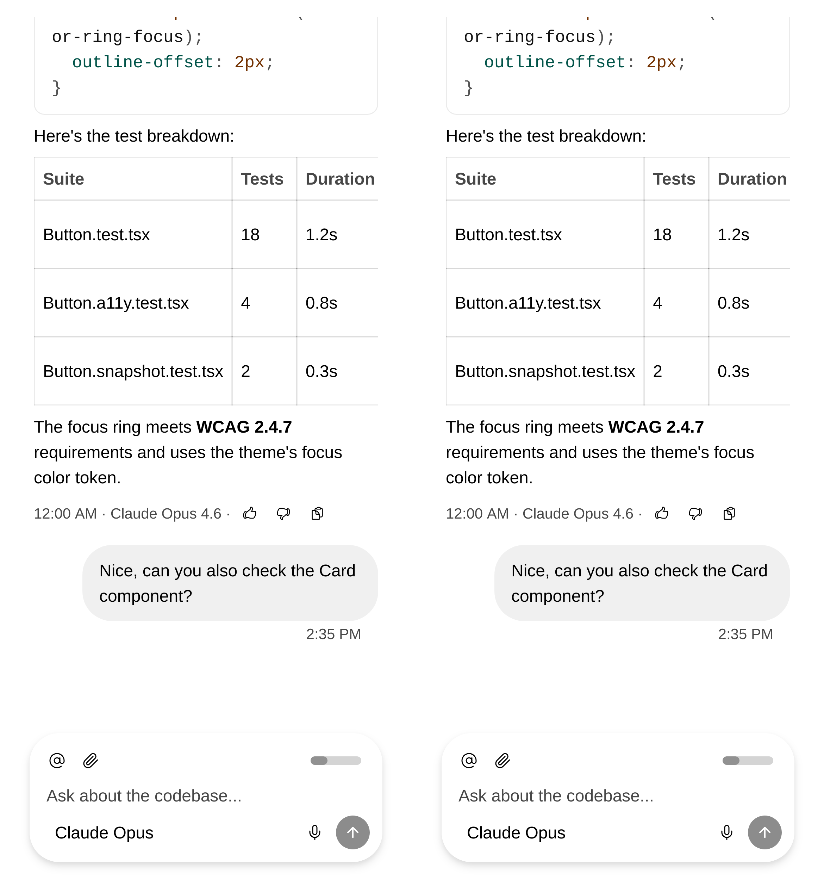

<!-- Template: new-feature.md -->
Stack: #9983 → #8217
Merge group: #9983, #8217

Review only this PR's change: https://github.com/vjeux/astryx/compare/86c74e8c304c69ffe8a5c2d57f591e19c35f3a1d...1fd9e0ed88a71bebaaa51876285faab06e92d09e, https://github.com/vjeux/astryx/compare/6fd4c287f900fc2e262c95da664f2aa6f0578701...680bf29d0c39692335dbde4a1322a39f1d2e82b7 and https://github.com/vjeux/astryx/compare/cc668a0e1bde4f872935b68286dcbb40a62315e1...8a7df57e539ad8bbf6686db12e24458bd7358ec1. Main merges sit between them. The last moves the bounce inside main's keyboard ride: https://github.com/vjeux/astryx/compare/52099ae9d10adc25ab68777f3f3f4aa7332df487..a56dc678209d1984bbb878c6916ad257f212e6e7. The head adds #9983's one-read fix, a sandbox page and a record fix: https://github.com/vjeux/astryx/compare/a56dc678209d1984bbb878c6916ad257f212e6e7...88d25e8682d1b92df31cdcc77714198d6354c75f.

## User need

In iOS Messages, dragging the conversation to the field, or swiping down on the input bar, puts the keyboard away. ChatLayout kept it up.

## Problem and solution fit

A watcher pan on the root lets the transcript scroll. With a software keyboard up, the field blurs when a touch or pen drag reaches the composer's top. A layer in the dock then bounces once on `springs.keyboard`, from the finger's speed, at most the composer's bottom padding, unless motion is reduced. The composer, frosted layer and scroll-to-bottom button share that layer. The bounce plays inside the dock's keyboard ride. Under a finger, focus then rests on the composer's group, as after Done.

A drag down from the composer blurs it too, unless a long press began it (caret loupe). While the keyboard is up, the page hold cancels one-finger drags that start on the composer, so nothing scrolls under it. Its own scrollers, a pinch and a zoomed page stay the browser's.

## Current specification

- `component:ChatLayout` FR10 and DEC-1, rewritten.
- Owner decision, Nov 5 2026 (Cindy, paraphrase): dismiss when the drag reaches the composer, with a brief spring bounce and no follow cue. The composer and the scroll-to-bottom button move together.
- Spec owners' ruling, Nov 5 2026 (paraphrase): a drag that starts on the composer closes the keyboard and never scrolls content under it.
- Spec owners' rulings, Nov 5–6 2026: `spec:AST-094` FR36 and FR37 except ChatLayout's two keyboard dismissals; FR19 lists the composer's hold.

## Public delta and caller burden

No new prop or type. ChatLayout's import grows by 26.6 kB gzip, mostly shared gesture code (Testing), which loads up front by owner decision (Cindy, Nov 4 2026).

## Design and alternatives

- Dismissing at the lift with an armed follow: rejected in DEC-1.
- Claiming the composer drag: its `touch-action` blocks pinch-zoom.
- Bouncing the dock container: the keyboard's ride owns its translate.

## Evidence

iOS 26.2 Simulator, sandbox page: both drags dismiss (Testing).

## Scope

- [x] One capability is added.
- [x] Unrelated fixes, cleanup, and policy changes were removed or split.
- [x] Consumer docs, focused tests, and migration evidence ship with the feature.
- [x] Public text and artifacts contain no internal Meta context.

## Writing rubric results

`component:ChatLayout`: R4, DEC-1's two one-line rejections; others none. `spec:AST-094` FR19, FR36, FR37 and FR43 lines and `spec:AST-099` paths: R1–R6 none.

## Testing

Behavior module: ChatLayout transcript dismissal (transcriptDismiss.ts)

ChatLayout's import, bytes (core build, esbuild, minified, React and StyleX external):

| | main (def46d15d9) | this change (4a546c248e) |
| --- | ---: | ---: |
| minified | 227,334 | 316,835 |
| gzip | 77,244 | 103,815 |

The gesture system's pan, host and page hold make 75 kB of the minified growth. The gesture system comes from the shared `gestures/` and `motion/` modules, the same files Slider, Toast and the date inputs ship. ChatLayout adds two modules of its own, `transcriptDismiss.ts` and `composerBounce.ts`.

- Red-first for the last merge, each arm on this head's tests, Chrome-profile crossing case in Chromium:
  - On the merge by text alone (fc4af427e8), it fails 5 of 5. The bounce hid the keyboard's ride, so the dock jumps 320.9 px in one 17 ms frame as the bounce ends.
  - Without the exact landing (5c19e3270d), it fails 5 of 5: the bounce's last frame snaps 0.28 px to rest.
  - Without the dock's containment while the bounce plays (4ee1c531af), it fails 5 of 5. The bounce grows the transcript's scroll range, and a scroll held at its end lifts the dock 1 to 2 px.
  - At this head it passes 20 of 20, with 1 worker and with 4.
- Red-first: on a build of 1fd9e0ed88, the browser spec's 4 crossing and composer cases fail in Chromium (2 of 2 runs) and in WebKit. On a build of 39a9502ca7, the pinch case fails in both engines: every two-finger move was cancelled. On a build of d19cf698ec's code, the drifting-strip case fails in both engines (Chromium 2 of 2): every move went through.
- The bounce case samples the bounce layer's animation paused at each frame. WebKit reads a running animation at each call, and a starved page paints few frames. Under CPU load in the WebKit container, the per-frame version failed 7 of 80 runs; this one passed 40 of 40.
- At this head, Chromium passes the dismissal spec 14/14 and main's keyboard spec 18/18. WebKit ran 10 times in the CI profile (`--cpus=4`, `CI=1`, `LP_NUM_THREADS=4`, 1 worker). The dismissal spec passed 120 and skipped 20 (the Chromium-only pen and Chrome-profile cases). Main's keyboard spec passed 120 and skipped 60 (Chromium-only).
- Units: `transcriptDismiss.test.ts` 32/32, `ChatLayoutTranscriptDismiss.test.tsx` 23/23, `composerBounce.test.ts` 7/7, `useChatKeyboard.test.tsx` 31/31, `dragAxes` 2/2. The theme-mark case fails on 9d66f5f3ad's source, and two strip cases on d19cf698ec's. Two cases cover a node made in another window; each fails with `instanceof` in place of `isNode` or `isElement`.
- On today's main, 955564d284's code fails Core's typecheck (`isNodeTarget` is gone) and its Storybook build. This head passes both.
- Mutants, each caught. A dismissal at the lift fails 11 units and two Chromium cases. A bounce on the composer alone fails the button case. A bounce on the dock container fails the Chrome-profile case (the merge by text above). Without the page hold, 4 units and both composer drags in Chromium fail. Without the composer pan, the drag down fails. A bounce at twice the finger's speed fails 3 units. Ignoring composer scrollers fails 2 units and the strip case. Dropping the long-press exception, the zoom check or the keyboard check fails 1 unit each. Counting a drift as the strip's axis fails 2 units and the drifting case.
- iOS 26.2 Simulator at this head, on the sandbox's Chat Layout page (no Storybook frame), HID drags, frames traced by the page:
  - A drag down the conversation blurred the field at the composer's top, 0.6 to 1 s before the lift.
  - The bounce layer then dipped 0.6 to 3.8 px. Each frame's translate fell back to exactly 0: 3.81, 2.53, 1.60, 1.12, 0.77, 0.52, 0.24, 0.13, 0.02, 0 px.
  - A drag down from the composer blurred it 104 to 149 ms after the touch. The page held 8 or 9 of its 11 moves, and the transcript stayed still.
  - In every traced frame, the composer stayed 44 px below the scroll-to-bottom button.
  - After any blur, Safari reports the keyboard only once it is down. The composer then drops to rest in one frame, about 0.46 s after the blur. A blur from script does the same on main def46d15d9 with this page, so it isn't this change.
- No keyboard open, on the sandbox's Chat Layout page: main def46d15d9 with that page, and this head. Chromium and WebKit, desktop (1280 × 800) and phone (390 × 844 at 3×). The composer, dock, field and scroll button sit at the same offsets (0 px each). The transcript's scroll height is equal, and the document does not scroll. At rest the dock has no containment. Captures, main left and this head right (https://github.com/vjeux/astryx/tree/7ad50852d320025f6e15937ff28228741b983f8f):

  
  
  
  
- The sandbox's Chat Layout page renders ChatLayout with no sandbox chrome, for phone recordings. The sandbox's tests pass 62/62 with its route, and its build verifies 829 routes. The page logs no error in Chromium or WebKit. The sandbox typecheck reports the same 6 errors as main, none in the page.
- At this head: test:ui 22,600 and test:node 17,413 passed; Chat accessibility specs 36/36. Core tsc, ESLint, `pnpm review:pre` and the repo checks (`sync:exports:check`, `verify-exports`, `check:repo`, `check:token-docs`, `check:motion-roles`, `check:changesets`, `check:knowledge`) pass.
- Preview at this head: {PREVIEW}

