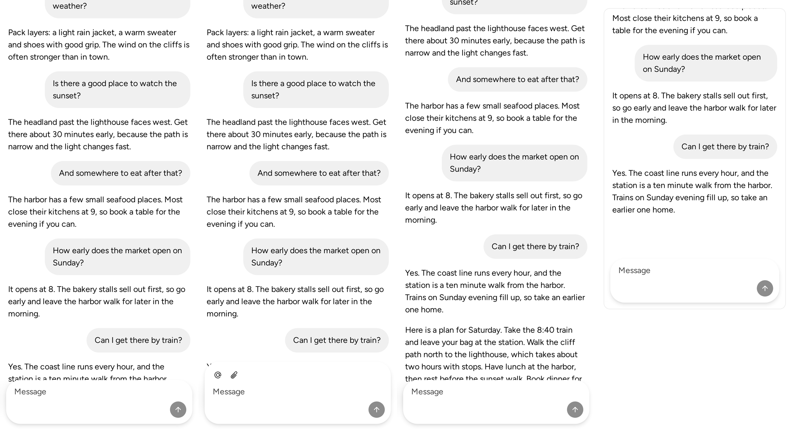

<!-- Template: maintenance.md -->

## Maintainer impact

Phone checks of ChatLayout run on Storybook frames and template previews, whose chrome and scrolling change what the composer does. Chat checks need one standalone page that scrolls like an app.

## Intended invariant

No product code changes. The Sandbox gains one raw page; the route list, catalog and hydration policy account for it, as for Perf Scenes.

## Change

- `apps/sandbox/src/app/(raw)/pages/chat-layout/` is a raw page with no sandbox chrome. `?case=` picks one of four cases (`cases.ts`), and the transcript opens with the case's name:

| Case | Shows | Scrolls |
| --- | --- | --- |
| `long` (the default) | A conversation several screens tall | The document, with the dock fixed to the viewport |
| `composer` | The composer with its Mention and Attach actions, for the software keyboard | The document |
| `streaming` | A reply streams in on open and after each sent message; the conversation follows it | The document |
| `docked` | The composer docked at the bottom of a fixed-height panel | ChatLayout itself, inside the panel |

- The page reads `?case=` in its first render, so `hydration-policy.ts` client-renders it when a case is named. The route list and catalog include it.

## Evidence

- Failure before the change: no Sandbox page renders ChatLayout.
- Success after the change, at d92232cd35, in Chromium and WebKit, on a phone (390 × 844) and a desktop (1280 × 800):
  - `long`, `composer` and `streaming`: the dock is fixed at the viewport's bottom. The document scrolls (phone: 3,188, 1,129 and 1,308 px over 844) from its end.
  - `streaming`: the reply streams to its 297 characters in about 2.5 s, and the document stays at its end.
  - `docked`: the dock sticks to the panel's bottom. ChatLayout scrolls (1,290 px over 589), and the document does not.
  - No page error or hydration warning in either engine. WebKit's container logs only blocked font preconnects.
  - Captures on a phone, left to right long, composer, streaming and docked (https://github.com/vjeux/astryx/tree/5919a695d8a07e67b71af2393f75268f2c2859a9):

    
    

- Product/runtime behavior verified unchanged: no package source changed. The page shows a ChatLayout gap main already has. In the document-scroll cases, the newest message ends 102 px under the fixed dock. The message area pads its end by 24 px, and the dock is 142 px tall. That is for a separate fix.
- CI impact: none; no workflow changes.

## Scope

- [x] No intended public API, product behavior, visual direction, or policy change.
- [x] Product changes discovered during the work were removed or split.
- [x] Public text and artifacts contain no internal Meta context.

## Testing

- `chatLayoutPage.test.tsx` (node project): each case server-renders its name, the transcript, the composer's input and its Send button. An unknown or missing case is `long`. The Mention and Attach actions render in the composer case only, and every case but `docked` scrolls the document.
- `route-manifest.test.ts`: the route is in the export list. `?case=` client-renders, and the page hydrates without a query.
- `pnpm -F @astryxdesign/sandbox test` (70 passed), the Sandbox build (832 routes verified), ESLint and Prettier pass. The Sandbox typecheck reports the same 6 errors as main, none in this page.
