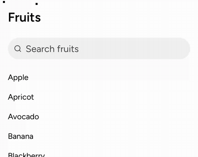
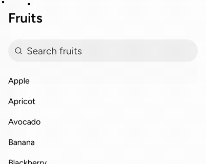
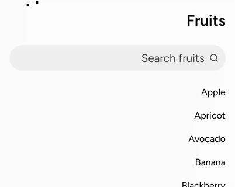
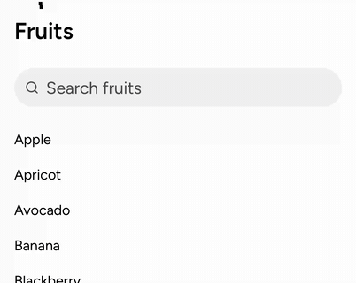

SearchField, the phone search field of iOS 26's UISearchController, re-cut from #9701 (closed) with its stacked placement only. It builds on the Core additions in @@COREPR@@.

Behavior module: SearchField and its touch layer (`useSearchFieldMotion`).

## User need

A phone app with a searchable list has no Lab search field that behaves like iOS 26's.

## Problem and solution fit

- A tap activates the field over UIKit's 383 ms ease-in-ease-out: it narrows, and a glass close button slides in beside it.
- With `lift`, the active field rises into its host's bar on the same clock, as under a navigation bar's large title.
- The close button or Escape cancels on the same clock: it clears the query and ends editing.
- A change of mind mid-motion turns from where the parts are and keeps their speed.
- With a mouse, the parts take their places at once. Under Reduce Motion, a finger cross-fades.

## Current specification

No record governs SearchField. The code, story and docs are new Lab files in its own folder, so the change is Lab-only under `architecture:knowledge-contracts` DEC-19.

## Public delta and caller burden

- Lab exports `SearchField`, `SearchFieldHandle` and `SearchFieldProps`.
- Props: the query and the active state, each controlled or not, plus `onSubmit`, `handleRef`, `lift` and the two button names.
- `astryx discover` lists it.

## Design and alternatives

- The field's background is three pieces: two rounded ends and a middle that scales. So the narrowing runs on the compositor, without layout.
- The pieces are pseudo-elements, because they are decoration with no role.
- The measured values live in Lab, in `internal/searchMotion.ts`.
- Rejected: animating `width`, which lays the page out every frame.
- Next: the bottom and tab placements, once Core's keyboard module opens to Lab.

## Evidence

Mobile Safari 26.2, iPhone 17 Pro simulator.

S1 activates and cancels. S2 types, clears and cancels. S3 is right to left. S4 has Reduce Motion on.

Red first, 1 worker: with no motion under a finger (72498b782b27d8aed37dab33670fef53da3b95c1), 3 units fail, 15 of 20 Chromium cases and 12 of 17 WebKit ones. One-line mutants fail their cases:

- a change of mind restarts (e23a51d12ed3566d3f0665c6566ac4fd34d5b42a): 1 unit and the two turn-around cases, both engines;
- cancel keeps the query (794f325f64985acbc1e152c1471ab2dba85769d1): 1 unit and the cancel case, both engines;
- the close button fades out on cancel (90ecddf932072d1b8474f6d13dce579e84428a3e): the cancel case, both engines.

## Scope

Components: SearchField

- [x] One capability is added.
- [x] Unrelated fixes, cleanup, and policy changes were removed or split.
- [x] Consumer docs, focused tests, and migration evidence ship with the feature.
- [x] Public text and artifacts contain no internal Meta context.

## Testing

Gates at 208ab0aceb7488dc04c5339f0fabd0fb2abe3ad6, on the Core commit 77625df506.

- `pnpm -F @astryxdesign/lab run typecheck`: 0 errors.
- `pnpm vitest run --project node --project ui packages/lab/src/SearchField packages/lab/src/internal/searchMotion.test.ts`: 31 passed.
- `pnpm storybook:build`: the index lists the four `lab-searchfield--*` stories.
- The SearchField interaction spec, 1 worker: Chromium 20 passed. WebKit 17 passed and 3 skipped (Chromium-only reads).
- `pnpm check:repo`, ESLint and Prettier: clean.
- `pnpm review:pre`: no findings.
