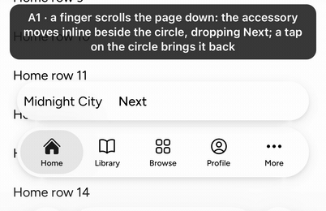
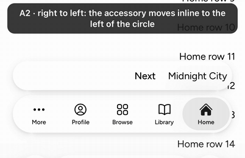
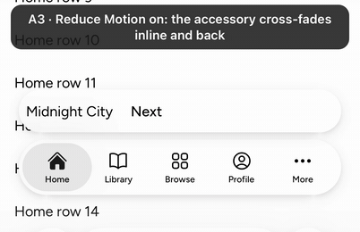

TabBar's bottom accessory, re-cut from #9701 (closed). It builds on the minimize pull request (@@MINPR@@).

## User need

An app with one persistent control, such as a mini player, has nowhere to put it on a lab TabBar. iOS 26 carries it above the bar and inline beside the minimized circle.

## Problem and solution fit

- `bottomAccessory` draws a 48 px capsule as wide as the bar, 8 px above it, as measured on iOS.
- When the bar minimizes, it moves down inline beside the circle and gets narrower, on UIKit's springs.
- A function gets the placement (`'expanded'` or `'inline'`), so the content can drop a control inline.
- Its content never shows past its glass while it grows, and a move turned around keeps its speed.
- Content that renders nothing draws no capsule.
- Under Reduce Motion it cross-fades.

## Current specification

No record governs the accessory; TabBar's draft record (#10929) covers More and disabled tabs. The code is Lab code; the story joins the existing `TabBar.stories.tsx`. So the change is mixed under `architecture:knowledge-contracts` DEC-19 and takes the owners' stamp.

## Public delta and caller burden

- `TabBar` gains `bottomAccessory?: ReactNode | ((placement) => ReactNode)` and exports `TabBarAccessoryPlacement`.
- Without it the DOM is unchanged.
- The app leaves 56 px more room at the bottom and declares the whole stack on `LayerProvider` (139 px), as the docs say.

## Design and alternatives

- The accessory's glass is drawn in the minimize pull request's three pieces, so a transform changes its width.
- Its content sits in a window whose trailing edge rides the glass's trailing cap.
- Rejected: animating `width`, which lays the page out every frame.
- Next: SearchField, then the search tab.

## Evidence

Mobile Safari 26.2, iPhone 17 Pro simulator, the Sandbox TabBar page with `?minimize=1&accessory=1`.

Red first, 1 worker: the minimize TabBar with these cases (bcf9646abbd8cc928afa83ac59ff970c70a27565) fails 2 units, all 8 Chromium cases and all 7 WebKit ones. One-line mutants fail their cases:

- never inline (f73c62c52607765f7419abaca6c1a20e7e04d45a): 1 unit and 5 cases per engine;
- jumps to its new box (9dc05fd180f74ca50bb22f733fd294441930d0ea): 5 Chromium cases and 4 WebKit ones;
- no window (b9d9301f9ca730668be179f5fda95bed3215ed04): "expanding, its content stays inside its glass", both engines;
- a turn from rest (94b752ad68ecff3fed81e0b6ac4402f96d94e97e): "turned around mid-move, it keeps its speed", both engines.

## Scope

Components: TabBar

- [x] One capability is added.
- [x] Unrelated fixes, cleanup, and policy changes were removed or split.
- [x] Consumer docs, focused tests, and migration evidence ship with the feature.
- [x] Public text and artifacts contain no internal Meta context.

## Testing

Gates at @@HEAD@@, on @@BASE@@.

- `pnpm -F @astryxdesign/lab run typecheck`: 0 errors.
- `pnpm vitest run --project node --project ui packages/lab/src/TabBar packages/lab/src/TabBarMoreList`: @@UNITS@@ passed.
- `pnpm storybook:build`: the index lists `lab-tabbar--bottom-accessory`.
- The whole TabBar interaction spec, 1 worker: Chromium @@CHR@@ passed. WebKit @@WK@@ passed and @@WKSKIP@@ skipped (Chromium-only reads).
- `pnpm check:repo`, ESLint and Prettier: clean.
- `pnpm review:pre`: no findings.
