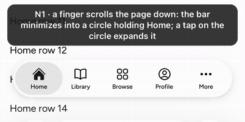
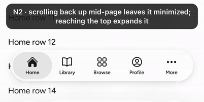
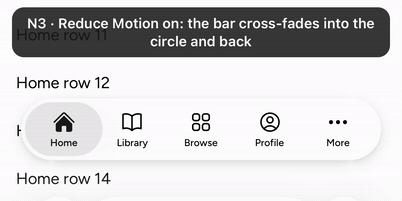
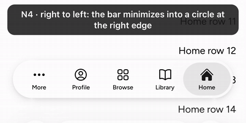

TabBar's minimize on scroll, re-cut from #9701 (closed; its More tab is #10619).

Behavior module: TabBar's minimize on scroll (`useTabBarMinimize`).

## User need

On long reading screens the bar covers content. iOS 26's tab bar minimizes as the page scrolls down; a lab TabBar cannot.

## Problem and solution fit

- With `minimizeBehavior="onScrollDown"` under a finger, the bar collapses into a circle 66 px into a downward scroll, as on iOS.
- Reaching the top, or a tap on the circle, expands it. Scrolling back up mid-page does not.
- Only the person's scrolling counts: a script's scroll moves nothing.
- The glass contracts in three pieces, the tabs fade as one layer, and the lens travels into the circle, on UIKit's springs.
- Minimized, the circle alone stands for the bar: the selected tab (More for a section inside More), collapsed. The tab list is inert.
- Under a mouse the bar stays expanded.

## Current specification

No record governs minimizing; TabBar's draft record (#10929) covers More and disabled tabs. The code is Lab code; the story joins the existing `TabBar.stories.tsx`. So the change is mixed under `architecture:knowledge-contracts` DEC-19 and takes the owners' stamp.

## Public delta and caller burden

- `TabBar` gains `minimizeBehavior?: 'never' | 'onScrollDown'`, default `'never'`. The bar watches its own page's scroll.
- At the default the DOM is unchanged: no bar box, platter or tab layer.

## Design and alternatives

- A pan on the page that never claims its touch starts the watch; Core's finger-scroll reader ends it. Its listeners are passive.
- The split glass and the circle mount only while the bar can minimize.
- `minimizeFade` stays a guess until video reads the glass morph (`@measure M-TB1`).
- Rejected: `scroll` alone, which counts scripts and keys.
- Next: the accessory, then SearchField and the search tab.

## Evidence

Mobile Safari 26.2, iPhone 17 Pro simulator, the Sandbox TabBar page with `?minimize=1` (it follows separately).

Red first, 1 worker: the base TabBar with these cases (637e2a6d8407b64bafe444ab52fe0dc7197969c3) fails 9 units, 18 of 20 Chromium cases and 16 of 17 WebKit ones. One-line mutants fail their cases:

- never minimizes (66b626b916d63578abe064bef85e5ab64b81b5b6): 7 units;
- a script's scroll counts (f42f9082e34a858f830af903acc1ab85189aa66a): 1 unit;
- no expand at the top (f8f74609e563a18d0b7318126ed8d14941b12ad4): 1 unit;
- the circle never expands (c7b34089863038a852a8311edaa23bd0830aef69): 1 unit;
- the lens stays put (8caeb75aa9b53aa3642f20812441b6968e674536): 2 browser cases per engine.

## Scope

Components: TabBar

- [x] One capability is added.
- [x] Unrelated fixes, cleanup, and policy changes were removed or split.
- [x] Consumer docs, focused tests, and migration evidence ship with the feature.
- [x] Public text and artifacts contain no internal Meta context.

## Testing

Gates at @@HEAD@@, on main @@MAIN@@.

- `pnpm -F @astryxdesign/lab run typecheck`: 0 errors.
- `pnpm vitest run --project node --project ui packages/lab/src/TabBar packages/lab/src/TabBarMoreList`: @@UNITS@@ passed.
- `pnpm storybook:build`: the index lists `lab-tabbar--minimize-on-scroll`.
- The whole TabBar interaction spec, 1 worker: Chromium @@CHR@@ passed. WebKit @@WK@@ passed and @@WKSKIP@@ skipped (Chromium-only reads).
- The passive-listener case compares against a story that never minimizes, since the test page holds one blocking listener of its own.
- `pnpm check:repo`, ESLint and Prettier: clean.
- `pnpm review:pre`: no findings.
