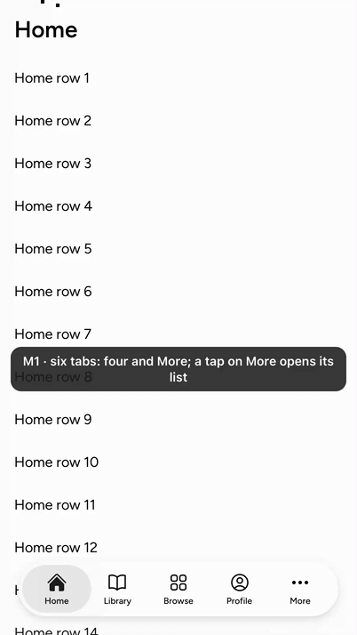
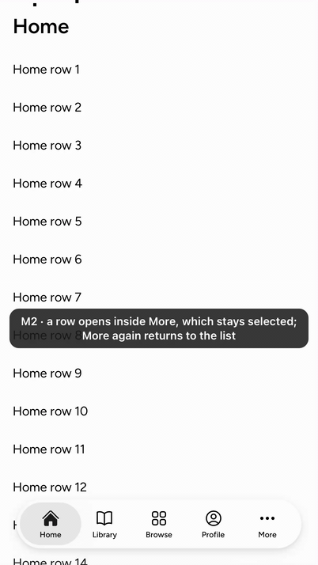
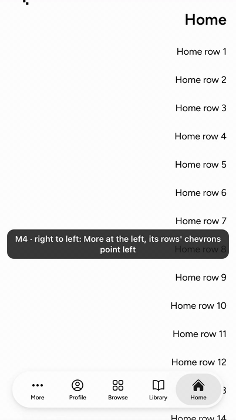
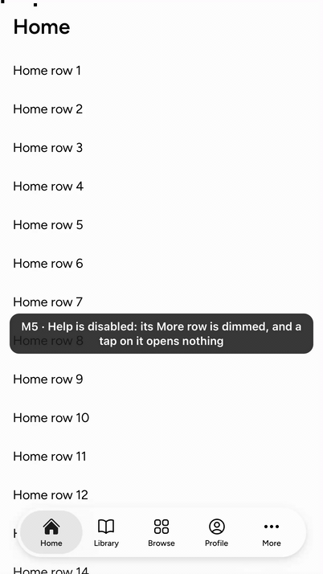
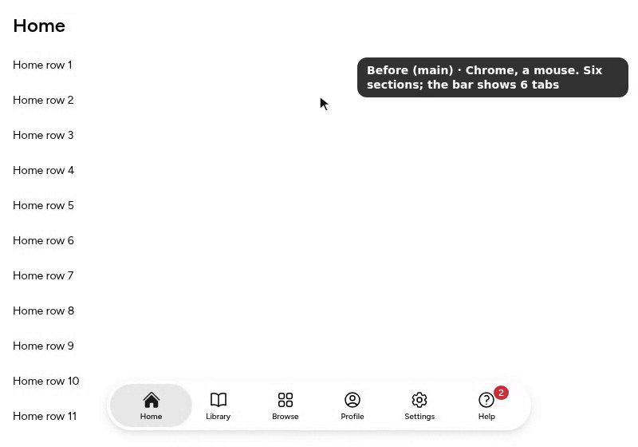
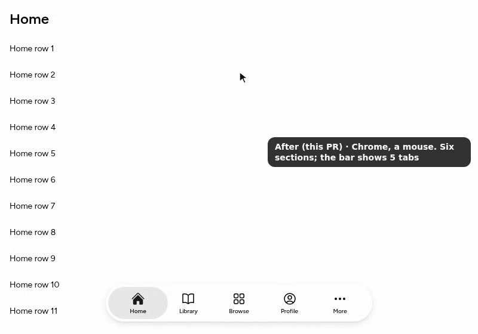

The lab TabBar's More tab, split from #9701.

## User need

Past five sections, tabs no longer fit a phone's bar. iOS shows four and More; a lab TabBar squeezes all in.

## Problem and solution fit

- Past five tabs, the bar shows four and More (FR1).
- More reads as selected while `value` is `moreValue` or a tab past the fourth.
- More again, holding a tab, calls `onReselect` (iOS pops More's stack).
- `TabBarMoreList` draws More's screen: a row per remaining tab (icon, label, Core's error `Badge`, chevron). A chosen row calls `onChange`.
- A disabled tab's row never activates (`spec:AST-085` FR2).

## Current specification

The owners' pointer ruling is recorded as FR1 in a draft record, `component:TabBar` (#10929), which takes its own stamp. FR1:

> Past five tabs the bar shows four tabs and More, which lists the rest, for every pointer, as UITabBarController does.

Every path is Lab code, an entry file or a changeset. That makes it Lab-only under `spec:AST-030` FR26, so it needs no owner decision (`architecture:knowledge-contracts` DEC-19).

## Public delta and caller burden

- `TabBar` gains `moreValue` (default `'more'`); five tabs or fewer render as before.
- New `TabBarMoreList`, rendered while `value` is `moreValue`:

```tsx
{tab === 'more' ? <TabBarMoreList onChange={setTab}>{tabs}</TabBarMoreList> : null}
```

- The More label is Core's `@astryx.tabBar.more` message (#10791), not public API.

## Design and alternatives

- The app owns More's navigation stack.
- `TabBarMoreList` has its own folder, docs, story, route.
- Rejected: TabBar drawing the list (owning a screen).
- Later: iOS's Edit, the accessory, minimize and search.

## Evidence

Mobile Safari 26.2, iPhone 17 Pro simulator, on a Sandbox page (`/pages/lab-tab-bar/`) following separately. M4 adds `?dir=rtl`, M5 `?disabled=help`.







M1–M5 each record one More case; as on iOS, M3's lens does not slide (`design:reduced-motion` DR2). They predate the folder move (no code change).

Desktop Chrome 149, mouse, same page. Before (main's TabBar, ba9c4c6e8f8e6ab68f22acf210a50302129bbc24): six tabs. After: four and More; a row opens its section; More again returns to the list.




Red first, 1 worker: main's TabBar (helpers exported) with the list, story and cases (04d355377bc7640e8d80b6f2ad9cd535ca42956c) fails all six More cases, both engines. More-again-chooses-More (1a3334200544c6b089056d2a4b46239c1ffd6be0) fails the reselect unit. Without disabled rows (bebe019982c6d88b59901581a6bbfe9e3841a37e), M5's case fails: units, both engines. Without the selected row (2c46f7d04e3060fda54dbe2e1c13eef49db47397), its unit fails. So does a hard-coded More label, on the tab (0fc04d688c41a59eeba4eed4fb16c09f9c9fb570) or the list (948f60e9a55bf9d820154b37de21b6ab6b4e80b1).

## Scope

Components: TabBar, TabBarMoreList

- [x] One capability is added.
- [x] Unrelated fixes, cleanup, and policy changes were removed or split.
- [x] Consumer docs, focused tests, and migration evidence ship with the feature.
- [x] Public text and artifacts contain no internal Meta context.

## Testing

Gates at 8900e2bb7b9492053579c434102800985d857b7d, rebased onto main b04c4143e6 after #9966. The one conflict, in TabBar's choose handler, keeps both behaviors: the selected tab scrolls its panel, and More again returns to its list without scrolling.

- `pnpm -F @astryxdesign/lab run typecheck`: 0 errors, docs included.
- `pnpm vitest run --project node --project ui packages/lab/src/TabBar packages/lab/src/TabBarMoreList`: 82 passed.
- Storybook typecheck: 0 errors. `pnpm storybook:build`: the index lists `lab-tabbarmorelist--more-tab` and `lab-tabbarmorelist--more-disabled-row`.
- The whole TabBar interaction spec, 1 worker: Chromium 74 passed. WebKit 64 passed and 10 skipped.
- The route-lock check (`node apps/docsite/scripts/generate-data.mjs`) and `node scripts/generate-cli-official-packages.mjs --check`: pass.
- `pnpm check:repo`, ESLint and Prettier: clean. The route lock keeps its generator's format.
- `pnpm review:pre`: no findings.
