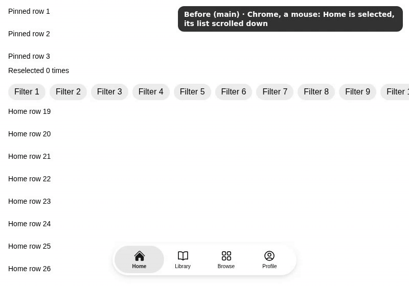
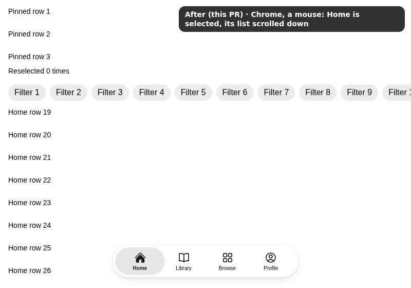

## User need

On iOS, tapping the current tab brings its section back to the top. Today each app must find and animate that section's scroll area, and a wrong guess scrolls the page.

## Problem and solution fit

Choosing the selected tab again (tap, click or key) scrolls that tab's own scroll area to its top. TabBar finds the panel by the tab's `panelId`: the panel itself if it scrolls vertically, else the first element inside that does. Core's scroll test skips a row that overflows by a pixel or less, or only sideways. Nothing else scrolls. It glides; under Reduce Motion it jumps. `onReselect` still fires, so an app can also reset its navigation stack.

## Current specification

- **Specs decision, Nov 4 2026:** "tap the current tab to scroll to top … scrolls only the active tab's own scroll area."
- **Decision:** choosing the selected tab again scrolls its panel to the top for every input: touch, mouse and keyboard.
- **Lab, not Core:** the behavior, mouse-click glide included, is Lab TabBar's (`packages/lab/src/TabBar/panelScroll.ts`).
- **Core:** no change. Core's internal entry already re-exports its scroll test by name (#10791), and the story is on main (#10922).

## Public delta and caller burden

No new props. A tab naming its panel (`panelId`) scrolls it on reselect; others behave as before. Put each section in a ScrollableArea inside its panel, or make the panel scroll:

```tsx
<div id="panel-home" role="tabpanel" aria-label="Home">
  <ScrollableArea label="Home">{rows}</ScrollableArea>
</div>
<TabBarItem value="home" label="Home" icon={<Icon icon={HomeIcon} />} panelId="panel-home" />
```

## Design and alternatives

- It uses the browser's smooth scroll, as Core's Carousel does.
- Core's scroll test (`measureLogicalScrollAxis`, as ScrollableArea uses) finds it.
- Rejected: a ref per tab (`panelId` already names the panel) and scrolling the document (it moves scrollers outside the tab).

## Evidence

Desktop Chrome 149, a mouse at normal speed, the story #10922 added (then named Scroll To Top). It was recorded at b661856c28, whose `TabBar.tsx` and `panelScroll.ts` equal this head's. Home's list is scrolled down, then a click, Enter and Space each choose Home again. Main never scrolls; this change glides it to the top each time, its pinned rows still. The page draws the pointer, which headless recordings lack.




## Scope

- [x] One capability is added.
- [x] Unrelated fixes, cleanup, and policy changes were removed or split.
- [x] Consumer docs, focused tests, and migration evidence ship with the feature.
- [x] Public text and artifacts contain no internal Meta context.

## Testing

Local gates at c72f46e5dbb0fd9c3d5a0158dc86ca87eaf8f3fa, on main 713d9ce6c6, node 24.22.1 from `.nvmrc`:

1. **Red-first, built Storybook, 1 worker:** main's TabBar with this PR's tests (6b7f9b8c2731e0c3085ccfc7d02b5e28abf97ed4) leaves the reselected panel where it was. The four scroll cases fail in each engine; choosing another tab still passes. Its four new unit cases fail too.
2. **Red-first, unit:** a lookup that takes the first element taller than its box (cff48b941777f38d2262448cdcfdef3738cec5af) takes a chip row that overflows by a pixel. The list below never scrolls (2 failed).
3. **Interaction specs, 1 worker:** the reselect cases 5/5 in Chromium and 5/5 in WebKit. The whole TabBar spec: Chromium 68 passed, WebKit 58 passed and 10 skipped.
4. **Units:** 74 in Lab's TabBar and TabBarMoreList.
5. **Static:** Lab typecheck; ESLint and Prettier on the changed files; `pnpm check:repo`; `review:pre`, no findings.
